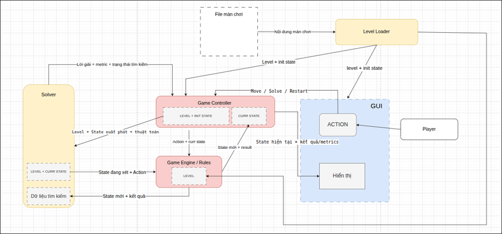
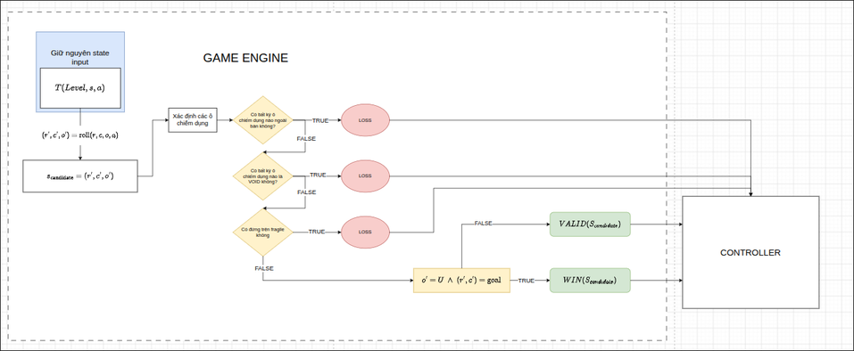

# Bloxorz Solver — Hướng dẫn đồ án và phân công nhóm

**Chơi trên web:** [Bloxorz · Quiet Worlds — Kazu](https://huyokazu.github.io/bloxorz-kazu/).
30 màn / 5 biome, camera 360°, hồ sơ local và engine Python chạy ngay trong
trình duyệt. Xem [build và triển khai](docs/deployment.md).

**Bản Kazu + lời giải thuật toán:** chạy `python Source/main.py --web` để mở
giao diện Kazu với bố cục gọn hơn. Nút **Lời giải** hiển thị kết quả riêng của
BFS, DFS, UCS, A*, so sánh số liệu và phát lại từng bước. Xem
[hướng dẫn UI](Source/web/README.md) và [kiểm tra bản tích hợp](docs/kazu-solutions-verification.md).
Giao diện web dùng lại engine Python; bản Tkinter vẫn chạy bằng lệnh không có `--web`.
Thay đổi này đang ở source local; website công khai cần build/deploy lại để cập nhật.

Tài liệu này giúp nhóm 5 thành viên hiểu yêu cầu, biết việc mình phải làm, biết cần trao đổi với ai và có tiêu chí kiểm tra trước khi nộp bài.

**Trạng thái hiện tại:** đã tạo bản chạy đầy đủ trong [Source](./Source/README.md): engine cơ bản/nâng cao, loader JSON, GUI, controller/worker, BFS/DFS/UCS/A*, 12 màn và công cụ thực nghiệm. **249 test Python và 84 test JavaScript đã đạt; 216 lượt đo đúng kết quả dự kiến, mọi lời giải FOUND đã replay qua engine.** Có dữ liệu gốc, bảng và 5 biểu đồ trong [results](./results/README.md). Môi trường đã kiểm tra là Python 3.12.14 trên Windows; mục tiêu nhóm vẫn là 3.13.x và cần kiểm tra lại trên máy nộp. Báo cáo PDF, video, tên/MSSV, deadline và nơi nộp chưa hoàn thiện. Xem [ghi chép xác minh](./docs/verification.md) và [bàn giao theo thành viên](./docs/report-parts/README.md).

**Nguồn yêu cầu:** [AI - Project 1.pdf](./AI%20-%20Project%201.pdf), môn CSC14003 — Introduction to Artificial Intelligence, Project 1: Bloxorz Solver. Số trang được ghi để nhóm tra lại đề gốc. Hai sơ đồ kiến trúc do nhóm cung cấp được lưu tại [docs/diagrams](./docs/diagrams/).

## Mục lục

1. [Cách đọc và việc cần làm ngay](#1-cách-đọc-và-việc-cần-làm-ngay)
2. [Mục tiêu và yêu cầu bắt buộc](#2-mục-tiêu-và-yêu-cầu-bắt-buộc)
3. [Thang điểm](#3-thang-điểm)
4. [Luật chơi và cách biểu diễn trạng thái](#4-luật-chơi-và-cách-biểu-diễn-trạng-thái)
5. [Phân công nhóm 5 người](#5-phân-công-nhóm-5-người)
6. [Kiến trúc và luồng xử lý](#6-kiến-trúc-và-luồng-xử-lý)
7. [Các giao tiếp phải thống nhất](#7-các-giao-tiếp-phải-thống-nhất)
8. [Định dạng màn chơi](#8-định-dạng-màn-chơi)
9. [Yêu cầu triển khai từng solver](#9-yêu-cầu-triển-khai-từng-solver)
10. [Cost function và heuristic](#10-cost-function-và-heuristic)
11. [Đo hiệu năng và thực nghiệm](#11-đo-hiệu-năng-và-thực-nghiệm)
12. [Các ca kiểm tra cần có](#12-các-ca-kiểm-tra-cần-có)
13. [Kế hoạch khoảng 3 tuần](#13-kế-hoạch-khoảng-3-tuần)
14. [Tổ chức mã nguồn và cách chạy](#14-tổ-chức-mã-nguồn-và-cách-chạy)
15. [Báo cáo PDF](#15-báo-cáo-pdf)
16. [Video demo](#16-video-demo)
17. [Nộp bài](#17-nộp-bài)
18. [Quy tắc phối hợp và lỗi thường gặp](#18-quy-tắc-phối-hợp-và-lỗi-thường-gặp)
19. [Checklist hoàn thành](#19-checklist-hoàn-thành)
20. [Thuật ngữ và thông tin nhóm cần điền](#20-thuật-ngữ-và-thông-tin-nhóm-cần-điền)

## 1. Cách đọc và việc cần làm ngay

### 1.1. Phân biệt yêu cầu của đề với quyết định triển khai

- **[BẮT BUỘC]**: yêu cầu được nêu trong đề, cần đáp ứng khi nộp bài.
- **[ĐÃ CHỐT]**: quyết định triển khai mặc định đã được duyệt cho nhóm. Áp dụng ngay; nếu nhóm đổi sau này thì cập nhật README và các module liên quan cùng lúc.
- **[CẦN ĐIỀN]**: thông tin thực tế chưa được cung cấp, chẳng hạn tên/MSSV, deadline chính thức, nơi nộp và link video. Các lựa chọn kỹ thuật đã có quyết định bên dưới.

Không có quy định trong đề bắt buộc phải dùng đúng tên class, cấu trúc thư mục, GUI framework, số lượng test hay lịch từng ngày của README này.

### 1.2. Mỗi người nên đọc phần nào trước?

| Người/nhóm | Đọc trước | Mục tiêu |
|---|---|---|
| Tất cả | Mục 2, 3, 4, 5, 7 | Hiểu sản phẩm, điểm số, luật và giao tiếp chung |
| Nhóm 1: Controller + báo cáo + video | Mục 6, 7, 13, 15, 16, 17 | Biết cách tích hợp và thu thập đầu ra |
| Nhóm 2: Solver + GUI | Mục 4, 7, 9, 10, 11, 12 | Biết state, thuật toán, metric và hiển thị |
| Nhóm 3: Game Engine | Mục 4, 6, 7, 8, 12 | Biết luật, dữ liệu màn và tiêu chí kiểm tra |

### 1.3. Việc cần làm trong buổi bắt đầu triển khai

- [ ] Điền tên/MSSV của 5 thành viên ở cuối README.
- [ ] Ghi deadline chính thức từ lớp/LMS; đề PDF không có ngày nộp cụ thể.
- [ ] Cài Python 3.13.x và kiểm tra Tkinter trên máy từng thành viên.
- [ ] Đọc các quy ước đã chốt ở mục 4, 7, 8 và 10; triển khai cùng model/API.
- [ ] Gán tên thật cho N1, N2A, N2B, N3A, N3B theo phạm vi ở mục 5.
- [x] Tạo cấu trúc mã nguồn ở mục 14 và màn `basic_01` ở mục 8.
- [x] Có luồng load → move → restart và cả bốn solver; mỗi thành viên chạy lại để hiểu phần mình.

**Mục tiêu đầu tiên:** tải một màn, vẽ được bàn, di chuyển đúng một khối, phát hiện thắng/thua và Restart đúng. Sau đó mới mở rộng; thiết kế `State` từ đầu phải đủ khả năng chứa cầu và split.

### 1.4. Bảng quyết định mặc định [ĐÃ CHỐT]

| Hạng mục | Phương án nhóm áp dụng | Lý do |
|---|---|---|
| Ngôn ngữ/môi trường mục tiêu | Python 3.13.x, Windows; lưu bản patch thực tế sau khi chạy kiểm tra | Một phiên bản chung, không phụ thuộc máy một người |
| GUI | Desktop 2D, Tkinter + ttk; bàn vẽ bằng Canvas | Vẽ đủ thông tin với ít phụ thuộc |
| Bốn solver | BFS, DFS dùng stack, UCS, A* | DFS dễ cài và kiểm tra hơn IDS trong tiến độ hiện tại |
| State | Frozen dataclass, các dữ liệu động dạng tuple, đầy đủ bridge và split | Hash được, tránh sửa chéo nhánh |
| Actions | UP, DOWN, LEFT, RIGHT; thêm SWITCH khi tách | Cùng thao tác chơi tay và tìm kiếm |
| Chọn cube | Space/SWITCH đổi A ↔ B; mặc định A sau split | Không có hai cách hiểu giữa GUI và solver |
| Độ dài lời giải | Tổng actions, kể cả SWITCH; báo thêm movement_count và selection_count | Dễ so sánh và không giấu thao tác điều khiển |
| Solve trong GUI | Từ current state chụp tại lúc bấm; cost mặc định UNIT | Hỗ trợ người đang chơi; kết quả cùng mốc xuất phát |
| Benchmark | Luôn từ initial state; bộ 12 màn cố định | So sánh có thể lặp lại |
| Cost | UNIT cho bốn solver; FRAGILE_PENALTY cho lượt so sánh thêm UCS/A* | Có baseline và thử nghiệm chi phí không đồng nhất |
| Heuristic A* | Reverse BFS trên đồ thị ô, bước 1/2 ô và cạnh teleport; h là max khoảng cách các ô bị chiếm | Bao phủ split với chi phí tính nhỏ, có lập luận đúng |
| Chạy solver trong GUI | Một worker process, Tkinter lấy kết quả qua queue bằng after | Không chạy tìm kiếm dài trong event handler |
| Replay | Có nút Replay, 250 ms/action; đi lại qua engine từ snapshot đã giải | Demo rõ và kiểm tra tích hợp |
| Đo memory | tracemalloc peak của lượt tìm kiếm, gồm bảng heuristic | Đơn giản, ghi rõ đây là Python allocations |
| Giới hạn một lượt | 30 giây total time, ngưỡng 256 MiB tracked memory | Các thuật toán có cùng ngân sách công bố |
| Thực nghiệm | 3 lượt/cấu hình; 12 màn × (4 UNIT + 2 weighted) × 3 = 216 lượt | Đủ bảng so sánh và giảm ảnh hưởng nhiễu |
| Kiểm tra/biểu đồ | pytest cho luật và tích hợp; matplotlib cho biểu đồ | Tách công cụ kiểm tra/phân tích khỏi game |
| Phân công, lịch, báo cáo, video | Áp dụng mục 5, 13, 15, 16; video mục tiêu 6–8 phút | Có đầu ra rõ và tránh quá tải người tổng hợp |

Các giá trị 12 màn, 3 lượt, 30 giây, 256 MiB, 250 ms và 6–8 phút là quyết định nội bộ, không phải quy định của thầy. Phiên bản dependencies đã kiểm tra ở Source/requirements-lock.txt; số liệu thực tế và môi trường ở results/raw. Không suy rộng hiệu năng từ bộ màn nhỏ này cho mọi màn Bloxorz.

## 2. Mục tiêu và yêu cầu bắt buộc

### 2.1. Sản phẩm cần xây dựng

Một chương trình Bloxorz cho phép:

1. Người chơi thao tác qua GUI.
2. Tải các màn chơi từ text/JSON.
3. Xử lý đầy đủ luật cơ bản và cơ chế nâng cao.
4. Gọi BFS, DFS, UCS và A* để tìm lời giải; đề cho phép IDS nhưng nhóm đã chọn DFS.
5. Ghi số liệu tìm kiếm để so sánh thuật toán.
6. Nộp mã nguồn, báo cáo PDF và link video demo.

Game là môi trường quan sát đầy đủ và xác định: cùng màn chơi, cùng trạng thái đầy đủ và cùng hành động thì có cùng kết quả. Đây là đồ án tìm kiếm trạng thái; không yêu cầu huấn luyện mô hình học máy.

### 2.2. Yêu cầu kỹ thuật — trang 4–6

- **[BẮT BUỘC]** Viết mã nguồn bằng Python.
- **[BẮT BUỘC]** Tự cài thuật toán tìm kiếm. Có thể dùng thư viện hỗ trợ GUI và cấu trúc dữ liệu, nhưng không gọi thư viện để giải thay BFS/DFS/UCS/A*.
- **[BẮT BUỘC]** Có GUI; desktop hoặc web đều được chấp nhận.
- **[BẮT BUỘC]** Có các điều khiển cơ bản, ví dụ New Game, Restart và các nút gọi solver.
- **[BẮT BUỘC]** Có định dạng text/JSON để cùng một màn được dùng lại giữa các solver.
- **[BẮT BUỘC]** Xử lý trạng thái lặp để tránh mắc kẹt trong chu trình.
- **[BẮT BUỘC]** Các solver xử lý đúng cả những ô nâng cao, không chỉ bàn cơ bản.
- **[BẮT BUỘC]** UCS có cost function được định nghĩa và giải thích.
- **[BẮT BUỘC]** A* có heuristic phù hợp, giải thích cách xây dựng và lập luận về admissible/consistent theo cost đã chọn.
- **[BẮT BUỘC]** Mỗi solver ghi search time, peak memory, expanded nodes và solution length.

### 2.3. Những điều đề cho phép

- Dùng DFS hoặc thay bằng IDS; nếu dùng IDS phải ghi rõ trong báo cáo.
- Tự thiết kế màn hoặc tái tạo màn cổ điển; cần ghi nguồn nếu tham khảo.
- Tự tổ chức mã nguồn, miễn rõ ràng và chuyên nghiệp.
- Dùng chi phí mỗi bước bằng 1 hoặc chi phí không đồng nhất có giải thích. Chi phí không đồng nhất được đề khuyến khích để UCS có ý nghĩa so sánh hơn.
- Dùng heuristic khác các gợi ý trong đề, miễn giải thích và phân tích được.
- Dùng AI; cần hiểu mã và ghi cách sử dụng trong phụ lục phù hợp. Giảng viên có thể phỏng vấn kiểm tra kiến thức.

**Không bắt buộc:** giao diện 3D, tái tạo toàn bộ màn gốc, animation phức tạp hoặc dùng một framework cụ thể. Replay/animation lời giải là cách demo hữu ích, được đề nêu như một khả năng minh họa.

## 3. Thang điểm

| Hạng mục | Điểm | Nội dung được yêu cầu | Nhóm chịu trách nhiệm chính |
|---|---:|---|---|
| Game cơ bản | 10 | Bàn, 3 tư thế, 4 hướng lăn, rơi, thắng | Nhóm 3; nhóm 2 hiển thị; nhóm 1 tích hợp |
| Game nâng cao | 10 | Fragile, bridge, soft/heavy/split, tách/ghép, toggle/permanent | Nhóm 3; nhóm 2 dùng đúng trong solver/GUI |
| BFS | 10 | Tự cài BFS và ghi số liệu | Nhóm 2 |
| DFS hoặc IDS | 10 | Tự cài và xử lý trạng thái lặp | Nhóm 2 |
| UCS | 10 | Tự cài, định nghĩa và giải thích cost | Nhóm 2 |
| A* | 10 | Tự cài, thiết kế và phân tích heuristic | Nhóm 2 |
| Báo cáo: mô tả thuật toán | 10 | Thuật toán và mô hình bài toán tìm kiếm | Nhóm 1 tổng hợp; nhóm 2/3 viết phần chuyên môn |
| Báo cáo: thực nghiệm | 20 | Bộ test cố định, metrics, bảng, biểu đồ, phân tích | Nhóm 2 đo/phân tích; nhóm 1 trình bày |
| Video: giao diện | 5 | Bàn, ô đặc biệt, tư thế và các điều khiển | Nhóm 1 làm video; nhóm 2 chuẩn bị GUI |
| Video: tính năng | 5 | Chơi tay, công tắc, thắng/thua và solver | Cả nhóm chuẩn bị; nhóm 1 quay/dựng |
| **Tổng** | **100** | | |

Nguồn: mục 3.1–3.7, trang 4–7. Phân công ở cột cuối là quyết định nội bộ đã duyệt, không phải cách chia điểm cá nhân của thầy. Controller không có mục điểm riêng nhưng là phần giúp toàn hệ thống hoạt động.

## 4. Luật chơi và cách biểu diễn trạng thái

### 4.1. Bàn và khối cơ bản — trang 1–3

- Bàn là lưới hữu hạn gồm floor, void và một goal.
- Khối nguyên vẹn có kích thước `1 × 1 × 2`, bắt đầu đứng trên ô xuất phát.
- Mỗi lượt lăn theo Up, Down, Left hoặc Right.
- Chỉ cần một phần khối nằm ngoài bàn hoặc trên void là khối rơi.
- Chỉ thắng khi khối nguyên vẹn đứng thẳng tại goal.
- Khối nằm ngang qua goal không thắng; không được gộp goal vào void trong bước kiểm tra rơi.

### 4.2. Quy ước tọa độ và tư thế [ĐÃ CHỐT]

| Ký hiệu | Ý nghĩa | Các ô bị chiếm |
|---|---|---|
| `U` | Đứng thẳng | `(r, c)` |
| `H` | Nằm ngang theo hàng | `(r, c)` và `(r, c+1)` |
| `V` | Nằm dọc theo cột | `(r, c)` và `(r+1, c)` |

Hàng `r` tăng xuống dưới, cột `c` tăng sang phải; chỉ số bắt đầu từ 0. Với H, tọa độ là ô bên trái; với V, tọa độ là ô phía trên. Engine, solver, loader và GUI phải dùng cùng quy ước.

| Tư thế hiện tại | Up | Down | Left | Right |
|---|---|---|---|---|
| `U` | `(r-2,c,V)` | `(r+1,c,V)` | `(r,c-2,H)` | `(r,c+1,H)` |
| `H` | `(r-1,c,H)` | `(r+1,c,H)` | `(r,c-1,U)` | `(r,c+2,U)` |
| `V` | `(r-1,c,U)` | `(r+2,c,U)` | `(r,c-1,V)` | `(r,c+1,V)` |

Ví dụ: `U(0,0) → Right → H(0,1) → Right → U(0,3)`. Lần đầu khối chiếm cột 1 và 2; lần sau đứng tại cột 3. Bảng chỉ tính hình học, chưa kết luận nước đi hợp lệ.

### 4.3. Cơ chế nâng cao [BẮT BUỘC] — trang 3–4

| Cơ chế | Luật cần xử lý |
|---|---|
| Fragile | Đỡ được khối nguyên vẹn đang nằm; khối đứng lên thì rơi |
| Bridge | Theo PDF: open đi được như floor; closed như void |
| Soft switch | Kích hoạt khi bất kỳ phần khối đè lên, đứng hoặc nằm |
| Heavy switch | Chỉ khối nguyên vẹn đứng thẳng mới kích hoạt |
| Split switch | Khối đứng lên thì dịch chuyển tới vị trí định trước và tách thành hai cube |
| Toggle | Mỗi lần kích hoạt đảo trạng thái các cầu liên kết |
| Permanent | Khi kích hoạt, đặt các cầu liên kết về trạng thái cố định |
| Split control | Điều khiển từng cube một; có thao tác chọn cube |
| Rejoin | Hai cube trên hai ô kề nhau theo cạnh ghép lại thành khối nguyên vẹn |
| Cube riêng | Kích hoạt được soft; không kích hoạt heavy và không tự thắng màn |

Đừng bỏ split vì khó: đề yêu cầu cả ba loại switch, split/rejoin và cả hai hành vi cầu. GUI, chơi tay và solver phải cùng hiểu các cơ chế này.

### 4.4. Phân biệt `Level`, `State`, `SearchNode`

| Dữ liệu | Chứa gì | Không nên chứa gì |
|---|---|---|
| `Level` | Frozen dataclass: grid tuple, start/goal, tuples định nghĩa bridge/switch và điểm teleport | Trạng thái cầu bị sửa trực tiếp khi solver thử nhánh |
| `State` | Vị trí/hình dạng khối, cấu hình cầu hiện tại, split và dữ liệu động cần thiết | Thời gian tìm kiếm, số node, toàn bộ đường đi |
| `SearchNode` | State, parent, action từ parent, g/depth nếu cần | Một bộ luật game riêng |
| `SearchResult` | Trạng thái kết quả, actions, metrics, tổng cost nếu có | Tự ý đổi phiên chơi hiện tại |

Biểu diễn đã chốt; N3A tạo `@dataclass(frozen=True, slots=True)` cho `State`:

```text
Khối nguyên: State(mode=MERGED, anchor=(r,c), orientation=o,
                  cubes=(), active_cube=None, bridges=B)
Khối tách:   State(mode=SPLIT, anchor=None, orientation=None,
                  cubes=(pA,pB), active_cube=0 hoặc 1, bridges=B)
```

Cube A/B giữ danh tính ổn định, không sắp xếp lại theo tọa độ sau khi di chuyển. Sau split, A là điểm đầu trong JSON, B là điểm thứ hai, active_cube=0. Sau merge, xóa cubes/active_cube và đặt anchor/orientation chuẩn. Tuple bridges sắp theo bridge ID tăng dần; giữ cùng thứ tự trong suốt màn.

**Khóa trạng thái là chính State bất biến.** Cùng vị trí nhưng cầu khác trạng thái, hoặc cùng hai cube nhưng khác active_cube, là các state khác nhau. Các quy tắc đã chốt không cần cờ pressed/latch bổ sung. Nếu sau này đổi luật cần lịch sử, phải đổi State/key tương ứng. Không đưa g, parent hoặc metrics vào khóa game state.

Dữ liệu lồng trong State/Level và các định nghĩa bridge/switch đều dùng tuple, primitive hoặc frozen dataclass, không để list/dict có thể sửa bên trong. Chỉ đưa dữ liệu thuần có thể pickle cho worker; không đưa GUI object hoặc handle vào Level/State. Mỗi transition tạo State mới; không sửa input hay cấu hình Level.

### 4.5. Quy tắc cho các trường hợp biên [ĐÃ CHỐT]

PDF không mô tả đầy đủ các tương tác dưới đây. Nhóm áp dụng những quy tắc cụ thể này và ghi rõ trong báo cáo là quy ước triển khai của nhóm:

| Vấn đề | Quy tắc áp dụng |
|---|---|
| Sự kiện nhấn switch | Chỉ khi mới đủ điều kiện: eligible(candidate) trừ eligible(old). Render hoặc SWITCH không kích hoạt |
| Nhiều toggle cùng bridge | Gộp theo parity: số toggle lẻ thì đảo, chẵn thì giữ |
| Toggle và permanent cùng bridge | Xử lý toggle trước; SET_OPEN/SET_CLOSED ghi đè sau. Loader từ chối hai SET trái nhau cho cùng bridge trong toàn màn |
| Permanent | Là phép SET mỗi lần nhấn; không khóa bridge vĩnh viễn chống mọi toggle sau đó |
| Cầu chưa bật và switch trong cùng bước | Kiểm tra nâng đỡ theo bridge cũ trước; nước đã rơi không được switch cứu |
| Bridge đổi dưới khối | Kiểm tra lại toàn khối/cả hai cube; bất kỳ phần nào mất nâng đỡ thì LOSS |
| Teleport tới switch khác | Không cho phép trong schema hiện tại: hai đích split là F thuần, khác nhau và không kề cạnh; không có chuỗi hiệu ứng |
| Cube trên fragile/goal | Cube được đứng trên các ô này; không phá fragile và không thắng goal |
| Hai cube | Chồng ô: INVALID_ACTION. Kề cạnh: auto-merge ngay sau di chuyển; kề chéo: không merge |
| Chọn cube | SWITCH đổi active 0 ↔ 1, không di chuyển, không effect; tính 1 action, cost 1 |
| Start | Đứng U trên F thuần, không đặt trên switch; dùng state goal riêng trong test solver |
| Solve | GUI từ current state snapshot; benchmark từ initial state; không có tùy chọn thứ hai trong bản đầu |

eligible(state): soft nếu ô bị chiếm bởi bất kỳ khối/cube; heavy/split chỉ khi MERGED-U đứng trên ô switch. Permanent không cần cờ “đã dùng”. Các đích split tuân thủ F thuần nên không phát sinh switch ngay sau teleport.

Những quyết định này không được tự ghi thành yêu cầu bắt buộc của thầy.

## 5. Phân công nhóm 5 người

### 5.1. Giữ nguyên ba nhóm đang thống nhất

| Nhóm | Số người | Phạm vi |
|---|---:|---|
| Nhóm 1 | 1 | Controller, tích hợp, tổng hợp báo cáo, video |
| Nhóm 2 | 2 | Bốn solver, GUI, đo và phân tích thực nghiệm |
| Nhóm 3 | 2 | Game Engine, Level Loader, state và luật game |

Ký hiệu N1, N2A, N2B, N3A, N3B để nhóm điền tên thật. Phân công nội bộ dưới đây đã duyệt làm mặc định; áp dụng ngay và cập nhật nếu nhóm đổi sau này.

### 5.2. Nhóm 1 — Controller + tích hợp + báo cáo + video

**Mục tiêu:** nối các module thành sản phẩm chạy được, quản lý phiên chơi và biến kết quả của cả nhóm thành báo cáo/demo đầy đủ.

| ID | Công việc cụ thể | Đầu ra/tiêu chí hoàn thành |
|---|---|---|
| C01 | Tạo entry point và nối Loader, Engine, Solver, GUI | Mở chương trình và tải được một màn |
| C02 | Quản lý level, initial/current state, trạng thái PLAYING/WON/LOST/SOLVING | Một nguồn dữ liệu phiên chơi rõ ràng |
| C03 | Nhận Move và thao tác chọn cube | Chuyển đúng action cho engine, cập nhật theo kết quả |
| C04 | Xử lý New Game/chọn màn | Tải cấu hình mới, xóa lời giải và dữ liệu phiên cũ |
| C05 | Restart | Khôi phục cả khối, cầu, split và các cờ động ban đầu |
| C06 | Gọi từng solver từ snapshot current state | Không làm hỏng current state trong lúc tìm kiếm |
| C07 | Nhận lời giải/metrics, xử lý thất bại hoặc giới hạn | GUI nhận kết quả có cấu trúc; lỗi có thông báo hiểu được |
| C08 | Replay 250 ms/action từ snapshot đã giải | Mỗi action đi qua engine; khóa thao tác xung đột khi replay |
| C09 | Một worker process tìm kiếm, GUI đọc queue bằng after | GUI phản hồi; khóa Move/Restart/chọn màn/Solve khi đang giải |
| C10 | Tích hợp đều đặn và kiểm tra luồng đầy đủ | Chơi tay, Restart, Solve, kết quả hoạt động trong một chương trình |
| C11 | Thu phần viết, hình, số liệu từ nhóm 2/3 | Báo cáo có cùng thuật ngữ và không thiếu hạng mục |
| C12 | Tổng hợp phân công và tỷ lệ hoàn thành | Bảng thành viên có căn cứ, không tự gán điểm |
| C13 | Lên kịch bản, quay/dựng video, thêm lời/subtitle | Link YouTube công khai, đưa vào Report.pdf |
| C14 | Kiểm tra gói nộp và hướng dẫn chạy | Máy/thư mục sạch có thể chạy theo README cuối |

**Không phải N1 tự viết mọi nội dung báo cáo.** Nhóm 2 bàn giao phần thuật toán, cost, heuristic, phương pháp đo và phân tích kết quả; nhóm 3 bàn giao mô hình state/luật và các ca kiểm tra. N1 tổng hợp, biên tập và hoàn thiện PDF.

**Bàn giao cho nhóm 2:** các hàm GUI dùng để gửi thao tác và cấu trúc dữ liệu controller gửi để render. **Nhận từ nhóm 3:** loader và API engine ổn định. **Nhận từ nhóm 2:** solver API, GUI và kết quả thực nghiệm.

### 5.3. Nhóm 2 — Solver + GUI

**Mục tiêu:** người dùng chơi/gọi solver được qua GUI; bốn thuật toán dùng chung engine và trả số liệu đáng tin cậy.

**N2A sở hữu GUI Tkinter + BFS + DFS dùng stack [ĐÃ CHỐT]:**

| ID | Công việc cụ thể | Đầu ra/tiêu chí hoàn thành |
|---|---|---|
| S01 | Làm màn hình bàn và phân biệt loại ô | Thấy được floor, void, goal, fragile, bridge và switch |
| S02 | Vẽ khối U/H/V và hai cube khi split | Vị trí hiển thị khớp occupied cells của engine |
| S03 | Nhận phím/nút và gửi cho controller | GUI không tự tính luật thắng/thua |
| S04 | Thêm New Game/chọn màn, Restart, BFS, DFS, UCS, A*, cost và Replay | Người dùng truy cập được các tính năng bắt buộc và replay đã chọn |
| S05 | Hiển thị trạng thái, action lời giải và metrics | Phân biệt đang giải, tìm thấy, vô nghiệm và timeout |
| S06 | Tự cài BFS | Queue, tránh lặp, truy vết; kiểm tra lời giải ngắn trên màn nhỏ |
| S07 | Tự cài DFS dùng stack, visited đầy đủ | Không mắc chu trình, không phụ thuộc recursion depth |
| S08 | Cùng N1 hiển thị/replay kết quả | GUI không ghi đè state bằng tọa độ tự đoán |
| S09 | Viết phần GUI, BFS, DFS cho báo cáo | Có cách hoạt động, dữ liệu, hạn chế và hình minh họa |

**N2B sở hữu UCS + A* + cost/heuristic + công cụ đo [ĐÃ CHỐT]:**

| ID | Công việc cụ thể | Đầu ra/tiêu chí hoàn thành |
|---|---|---|
| S10 | Tự cài UCS | Priority queue theo g, cập nhật đường rẻ hơn, goal test đúng |
| S11 | Định nghĩa cost | Công thức, đơn vị, lý do và ví dụ; ghi total cost |
| S12 | Tự cài A* | Priority theo g+h, best_g và xử lý đường tốt hơn |
| S13 | Thiết kế heuristic | Lập luận admissible/consistent theo cost, xét teleport/split |
| S14 | Thống nhất SearchResult và bộ đo chung với N2A | Cả bốn solver trả cùng cấu trúc metrics |
| S15 | Tạo runner thực nghiệm chạy không phụ thuộc GUI | Cùng bộ màn/start state, xuất dữ liệu có cấu trúc |
| S16 | Tổng hợp bảng/biểu đồ với N2A | Đủ bốn metrics, có kết quả lỗi/giới hạn rõ ràng |
| S17 | Viết phần UCS, A*, cost, heuristic cho báo cáo | Phân tích đúng mục tiêu tối ưu và điều kiện bảo đảm |

**Hai người cùng chịu trách nhiệm:** solver trên advanced tiles; bộ test cố định; kiểm tra lời giải bằng engine; phân tích thực nghiệm; phần giới hạn của phương pháp đo.

**Tiêu chí nghiệm thu nhóm 2:** bốn thuật toán được gọi từ GUI; dùng cùng transition/goal logic; lời giải replay được; có đủ metrics; không bỏ bridge state hoặc split trong khóa; có phần viết và số liệu để bàn giao cho N1.

### 5.4. Nhóm 3 — Game Engine + Level Loader

**Mục tiêu:** luật đúng, state đầy đủ và không bị sửa chéo giữa các nhánh tìm kiếm. Đây là nền tảng mà cả controller lẫn solver phụ thuộc.

**N3A sở hữu model chung + luật cơ bản + loader [ĐÃ CHỐT]:**

| ID | Công việc cụ thể | Đầu ra/tiêu chí hoàn thành |
|---|---|---|
| E01 | Cùng N3B thiết kế Level/State/Action/TransitionResult | Có khả năng mở rộng bridge và split ngay từ đầu |
| E02 | Định nghĩa U/H/V, anchor và occupied cells | GUI/solver không phải đoán cách khối chiếm ô |
| E03 | Cài 12 trường hợp lăn | Đúng bảng ở mục 4.2, có kiểm tra từng trường hợp |
| E04 | Kiểm tra biên và void | Kiểm tra mọi ô bị chiếm, không chỉ anchor |
| E05 | Kiểm tra thắng | Chỉ MERGED + U + tại goal thắng |
| E06 | Viết Loader cho text/JSON | Trả level và initial state, báo lỗi cấu hình rõ |
| E07 | Kiểm tra cấu hình màn | Kích thước, start/goal, ID và liên kết, điểm teleport |
| E08 | Tạo màn cơ bản/biên/vô nghiệm | Dùng được trong GUI, solver và kiểm tra engine |
| E09 | Giữ state input và level không bị mutate | Thử nhiều hướng không ảnh hưởng nhau |

**N3B sở hữu luật nâng cao + state nâng cao [ĐÃ CHỐT]:**

| ID | Công việc cụ thể | Đầu ra/tiêu chí hoàn thành |
|---|---|---|
| E10 | Fragile | Khối nằm an toàn; đứng rơi; quy tắc cube được ghi rõ |
| E11 | Bridge configuration | State chứa tình trạng cầu, kiểm tra nâng đỡ theo cấu hình |
| E12 | Soft/heavy switch | Nhận diện đúng điều kiện kích hoạt và sự kiện nhấn |
| E13 | Toggle/permanent và liên kết nhiều cầu | Hiệu ứng rõ, thứ tự khi nhiều switch được chốt |
| E14 | Split/teleport | Chuyển mode và vị trí cube đúng cấu hình |
| E15 | Điều khiển cube | Mỗi bước di chuyển một cube, chọn cube theo action model |
| E16 | Rejoin | Ghép khi kề cạnh, chọn anchor/tư thế chuẩn, không ghép kề chéo |
| E17 | Kiểm tra sau hiệu ứng | Không bỏ qua cube đứng yên hoặc mất nâng đỡ sau khi cầu đổi |
| E18 | Tạo màn advanced có mục tiêu kiểm tra rõ | Soft, heavy, toggle, permanent, split và tổ hợp |
| E19 | Viết phần luật/state nâng cao cho báo cáo | Nêu trường hợp biên và quy tắc nhóm chọn |

**Hai người cùng chịu trách nhiệm:** API engine duy nhất; khóa state đầy đủ; các thay đổi model được thông báo cho nhóm 1/2; không để engine cơ bản và nâng cao thành hai bộ luật không tương thích.

**Tiêu chí nghiệm thu nhóm 3:** cùng engine dùng được khi chơi tay và tìm kiếm; core/advanced có ca kiểm tra; loader đọc lại màn được; initial state tái tạo đầy đủ; transition không sửa input; toàn bộ luật đặc thù đã có quyết định bằng văn bản.

### 5.5. Ai viết phần nào trong báo cáo?

| Nội dung | Người viết đầu tiên | Người tổng hợp |
|---|---|---|
| Tổng quan, phân công, kiến trúc controller | N1 | N1 |
| GUI, BFS, DFS | N2A | N1 |
| UCS, A*, cost, heuristic | N2B | N1 |
| Đo lường, bảng, biểu đồ, nhận xét | N2A + N2B | N1 |
| Level, state, lăn, goal/validity | N3A | N1 |
| Bridge, switch, split/rejoin, các quy tắc biên | N3B | N1 |
| Tài liệu tham khảo, cách dùng AI | Mỗi người cung cấp phần mình dùng | N1 |
| Kịch bản và màn demo | Cả nhóm | N1 quay/dựng |

## 6. Kiến trúc và luồng xử lý

### 6.1. Sơ đồ tham khảo





Sơ đồ thứ nhất mô tả các module và luồng dữ liệu. Sơ đồ thứ hai mô tả engine cơ bản; tuple `(r,c,o)` trong hình chưa đủ cho cầu và split. Hai hình là tài liệu thiết kế tham khảo của nhóm, không phải nội dung thang điểm trong PDF.

### 6.2. Trách nhiệm từng module

| Module | Làm gì | Ranh giới cần giữ |
|---|---|---|
| Loader | Đọc/kiểm tra màn và tạo initial state | Không giữ phiên chơi đang chạy |
| Engine | Chuyển trạng thái, kiểm tra luật/goal | Không render, không quản lý queue tìm kiếm |
| Solver | Chọn trạng thái để khám phá, truy vết, đo số liệu | Không viết lại luật lăn hoặc sửa current state |
| Controller | Quản lý phiên, điều phối action/solve/restart | Không tự cài transition khác engine |
| GUI | Nhận thao tác, vẽ, trình bày kết quả | Không là nguồn quyết định tính hợp lệ của nước đi |

### 6.3. Các luồng chính

```text
Load:   File → Loader → Level + initial_state → Controller → GUI
Move:   Player → GUI → Controller → Engine → Controller → GUI
Solve:  GUI → Controller → Solver → gọi Engine nhiều lần → SearchResult → GUI
Replay: Các action lời giải → Controller → Engine → GUI
Restart: Controller khôi phục initial_state đầy đủ → GUI
```

Solve là khám phá các state giả định. Solver không được di chuyển khối thật trên GUI theo từng nhánh nó thử. Replay diễn ra sau khi có lời giải và là một luồng riêng.

**Chạy nền đã chốt:** controller tạo đúng một worker process bằng multiprocessing với start method `spawn`. Worker chỉ nhận dữ liệu thuần Level/State/config và trả SearchResult hoặc lỗi qua queue; không gọi Tkinter. Main thread lấy kết quả bằng `root.after(50, ...)`, cập nhật GUI và không chờ `join()` chặn event loop. Entry point có guard `if __name__ == "__main__"`; hàm worker ở cấp module để spawn được trên Windows.

Trong khi SOLVING hoặc REPLAYING, khóa Move, Space, Restart, chọn màn, đổi thuật toán/cost và Solve. Cửa sổ vẫn phản hồi và cho phép đóng; khi đóng phải dọn worker. Mỗi request có ID và snapshot; kết quả chỉ được nhận nếu còn khớp request hiện tại. Bản đầu không làm nút Cancel riêng. N1 sở hữu vòng đời worker; N2B cung cấp hàm solve/config có timeout, N2A sở hữu hiển thị.

Sau FOUND, nút Replay khôi phục snapshot đã giải, áp từng action qua engine mỗi 250 ms. Nếu người chơi đã di chuyển/Restart/chọn màn sau lần giải, controller xóa kết quả cũ và vô hiệu Replay. Replay xong về WON; lỗi replay được báo rõ, không tự sửa state để ép thắng.

### 6.4. Thứ tự xử lý engine [ĐÃ CHỐT]

```text
Nhận Level + State + Action
→ nếu state đã goal: INVALID_ACTION; không chuyển tiếp sau terminal
→ nếu SWITCH: chỉ đổi active khi SPLIT, trả VALID; không phát effect
→ tính bước hình học của khối nguyên hoặc cube đang chọn
→ nếu hai cube chồng ô: INVALID_ACTION
→ nếu hai cube kề cạnh: auto-merge H/V ngay
→ tính occupied cells và kiểm tra nâng đỡ toàn state với bridge CŨ
→ nếu ngoài bàn/void/cầu tắt/đứng nguyên trên fragile: LOSS
→ lấy switch mới nhấn: eligible(candidate) - eligible(input)
→ gộp các TOGGLE theo parity rồi áp SET_OPEN/SET_CLOSED
→ nếu nhấn split: teleport đến F thuần, mode SPLIT, active=A
→ kiểm tra lại nâng đỡ toàn state với bridge MỚI
→ kiểm tra goal
→ trả VALID / WIN / LOSS và events
```

Action không áp dụng được trả INVALID_ACTION, không làm thua. Khi LOSS, controller giữ hình trạng thái hợp lệ cuối, hiện thông báo thua và khóa Move cho đến Restart/New Game; không làm animation rơi trong bản này. Nhóm 3 triển khai đúng thứ tự trên, nhóm 2 chỉ sử dụng kết quả.

## 7. Các giao tiếp phải thống nhất

### 7.1. API chung [ĐÃ CHỐT]

Các module hiện sử dụng API chung dưới đây; tests kiểm tra engine, solver, controller và replay theo hợp đồng này:

```text
load_level(path)                           → (Level, initial_State)
occupied_cells(State)                      → các tọa độ bị chiếm
available_actions(State)                   → các Action theo mode đã chốt
transition(Level, State, Action)            → TransitionResult
is_goal(Level, State)                      → bool
state_key(State)                           → khóa đầy đủ, hash được
step_cost(Level, State, Action, next_State, events, policy) → int >= 1
solve(Level, start_State, algorithm, config)→ SearchResult
controller.handle_action(Action)           → cập nhật phiên và dữ liệu GUI
controller.restart()                       → khôi phục initial state
```

`is_goal` thống nhất với WIN của transition. `state_key(state)` trả chính State bất biến. `available_actions` trả `(UP, DOWN, LEFT, RIGHT)` khi MERGED; thêm SWITCH cuối khi SPLIT. Hàm này không thử trước nước nào sẽ rơi; transition quyết định kết quả.

Nhóm 3 sở hữu action/transition/state key; N2B sở hữu cost policy, dùng state/events công khai. Cả bốn solver dùng cùng API. Thứ tự action cố định là UP, DOWN, LEFT, RIGHT, SWITCH; DFS phải push theo thứ tự đảo để thứ tự khám phá thực tế vẫn theo quy ước này.

### 7.2. Kết quả chuyển trạng thái

| Trường | Ý nghĩa |
|---|---|
| `status` | VALID, WIN, LOSS, INVALID_ACTION |
| `next_state` | State mới khi VALID/WIN; None khi LOSS/INVALID_ACTION |
| `reason` | Lý do rơi/thao tác không áp dụng được để debug/hiển thị |
| `events` | Tuple GameEvent; kind + object_id: SWITCH_PRESSED, BRIDGE_CHANGED, SPLIT, MERGE |

Không trả candidate để làm animation rơi trong bản đầu. INVALID_ACTION giữ phiên PLAYING, không tính bước. Cost tính riêng theo mục 10, không sửa luật. Khi mất nâng đỡ sau effect, events có thể phục vụ debug nhưng không commit một next_state bất hợp lệ vào phiên chơi.

### 7.3. Kết quả tìm kiếm

| Trường | Ý nghĩa |
|---|---|
| `status` | FOUND, NO_SOLUTION, TIMEOUT, MEMORY_LIMIT; ERROR nếu có lỗi |
| `actions` | Chuỗi action từ start state tới goal khi FOUND |
| `search_time_seconds` | Thời gian vòng tìm kiếm, không gồm tiền xử lý heuristic |
| `preprocessing_time_seconds` | Thời gian dựng bảng heuristic; 0 với thuật toán không dùng |
| `total_time_seconds` | preprocessing + search; dùng cho biểu đồ chính và giới hạn 30 giây |
| `peak_memory_bytes` | Peak memory theo phương pháp đo đã công bố |
| `expanded_nodes` | Số lần mở rộng theo quy tắc chung |
| `solution_length` | len(actions), gồm SWITCH; None nếu không FOUND |
| `movement_count`, `selection_count` | Số action hướng và số SWITCH; tổng bằng solution_length |
| `solution_cost` | Tổng cost theo policy đã chọn; None nếu không FOUND |
| `metadata` | Cấu hình đo, heuristic, giới hạn, thông tin bổ sung nếu cần |

NO_SOLUTION chỉ dùng khi đã tìm hết phần không gian cần tìm mà không có goal. TIMEOUT không chứng minh vô nghiệm. Với start state đã là goal, lời giải rỗng là hợp lệ.

### 7.4. Checklist triển khai hợp đồng đã duyệt

- [x] Có models.py và enum theo mục 4/7 — N3A tiếp nhận.
- [x] Advanced dùng cùng State và thứ tự effect — N3B tiếp nhận.
- [x] Có JSON schema/Loader theo mục 8 — N3A tiếp nhận.
- [x] Các solver dùng cùng available_actions, state_key, SearchResult — N2A/N2B tiếp nhận.
- [x] Có UNIT/FRAGILE_PENALTY và heuristic ở mục 10 — N2B tiếp nhận.
- [x] Có snapshot current state, worker và replay — N1 tiếp nhận.
- [x] GUI hiển thị metrics và trạng thái worker — N2A tiếp nhận.
- [x] Có bộ đo và test cố định ở mục 11 — Nhóm 2 tiếp nhận.

Các dấu hoàn thành xác nhận chức năng trong bản mã được hỗ trợ viết và kiểm tra bằng Codex; không thay cho thông tin đóng góp thực tế của từng thành viên. Mỗi người vẫn cần hiểu và kiểm tra phần mình trên máy của nhóm.

## 8. Định dạng màn chơi

### 8.1. JSON schema dùng chung [ĐÃ CHỐT]

Đề bắt buộc có text/JSON; nhóm chọn JSON. Mỗi màn là một file UTF-8 trong Source/levels, dùng chung cho game và mọi solver. Không hard-code bàn riêng trong solver.

Màn `basic_01.json` phải tạo đầu tiên theo dữ liệu sau:

```json
{
  "id": "basic_01",
  "grid": [
    ".......",
    ".FFFGF.",
    "......."
  ],
  "start": [1, 1],
  "goal": [1, 4],
  "bridges": [],
  "switches": []
}
```

Lời giải kiểm tra là Right, Right. File Source/levels/basic_01.json và loader đã triển khai, test xác nhận chuỗi này kết thúc WIN.

| Ký tự grid | Loại ô | Yêu cầu dữ liệu |
|---|---|---|
| `.` | Void | Không có đối tượng liên kết |
| `F` | Floor | Start và điểm teleport đặt trên F thuần |
| `G` | Goal | Đúng một G, trùng trường goal |
| `O` | Fragile | Không có bridge/switch chồng ô |
| `B` | Bridge | Mỗi ô B thuộc đúng một bridge |
| `S` | Soft switch | Có đúng một định nghĩa SOFT tại ô |
| `X` | Heavy switch | Có đúng một định nghĩa HEAVY tại ô |
| `T` | Split switch | Có đúng một định nghĩa SPLIT tại ô |

Bridge có `id`, `cells`, `initial_enabled`; IDs dạng chuỗi và sắp tăng dần khi tạo tuple flags. Switch có `id`, `cell`, `type`, `effects`; mỗi effect có `bridge_id`, `operation` thuộc TOGGLE/SET_OPEN/SET_CLOSED. SPLIT thêm `destinations` đúng hai tọa độ. SOFT/HEAVY không có destinations.

Ví dụ cấu trúc một bridge và một switch dưới đây chỉ minh họa object; chúng không thuộc màn basic_01 phía trên:

```json
{
  "bridge": {
    "id": "bridge_01", "cells": [[1, 4]], "initial_enabled": false
  },
  "switch": {
    "id": "soft_01", "cell": [1, 2], "type": "SOFT",
    "effects": [{"bridge_id": "bridge_01", "operation": "TOGGLE"}]
  }
}
```

Một SPLIT có thể có effects lên bridge theo cùng schema, nhưng hai destinations luôn là F thuần, khác nhau, không kề cạnh. Không cho một ô chồng nhiều loại. Gộp effects của tất cả switch mới nhấn theo mục 4.5, không phụ thuộc thứ tự object trong JSON.

### 8.2. Loader cần phát hiện cấu hình sai

- Hàng có độ dài không thống nhất hoặc loại ô không nhận diện được.
- Start/goal ngoài bàn; start không hợp lệ; thiếu hoặc mâu thuẫn goal.
- ID bị trùng, switch trỏ tới bridge không tồn tại.
- Bridge/switch có tọa độ ngoài bàn hoặc loại ô chồng chéo không được schema cho phép.
- Split thiếu điểm teleport hoặc điểm không hợp lệ theo luật đã chốt.
- Thiếu cấu hình động ban đầu cần thiết.
- Hai effect SET_OPEN và SET_CLOSED ở bất kỳ switch nào cùng trỏ một bridge; schema bản này từ chối cấu hình mâu thuẫn đó.

Loader kiểm tra cấu trúc/hợp lệ của màn không có nghĩa phải chạy solver để chứng minh mọi màn giải được; màn vô nghiệm hợp lệ vẫn hữu ích để kiểm tra.

## 9. Yêu cầu triển khai từng solver

### 9.1. Phần dùng chung

- Dùng cùng Level, State, transition, goal logic và state key.
- Sinh action bằng available_actions; state tách và active_cube không được bỏ qua.
- Chỉ đưa VALID/WIN có next_state vào frontier; bỏ LOSS/INVALID_ACTION. Không tự Restart rồi xem đó là successor.
- Lưu parent/action để truy vết, không sao chép toàn bộ đường đi cho mọi node nếu không cần.
- Kiểm tra lời giải bằng cách áp lại actions qua engine từ đúng start state.
- Ghi metrics và trả cùng SearchResult.
- Thứ tự action theo mục 7; heap dùng bộ đếm tăng dần để phá tie, không so sánh trực tiếp State.

### 9.2. BFS — 10 điểm

- Frontier là queue FIFO, thường dùng `deque`.
- Đánh dấu state đã thấy khi enqueue để giảm lặp trong hàng đợi.
- Duyệt theo độ sâu tăng dần.
- Tối ưu tổng số action, gồm cả SWITCH. Báo riêng movement_count để không gọi đây là số lần lăn tối ưu.
- Không tối ưu tổng cost không đồng nhất.
- Bộ nhớ có thể lớn vì lưu frontier, visited và parent.

### 9.3. DFS hoặc IDS — 10 điểm

Đề cho phép DFS hoặc IDS; **nhóm chọn DFS iterative dùng stack**, không triển khai IDS trong bản này.

- Full-state visited; đánh dấu khi push và lưu parent của lần đầu phát hiện.
- Push successor theo thứ tự đảo để pop theo UP, DOWN, LEFT, RIGHT, SWITCH.
- Không dùng recursion để tránh giới hạn độ sâu Python.
- DFS không bảo đảm lời giải ngắn/rẻ nhất; có thể duyệt hết đồ thị hữu hạn nếu không vượt ngân sách.
- Báo memory đo thực tế, gồm cả visited/parent, không khẳng định DFS luôn ít memory.

### 9.4. UCS — 10 điểm

- Frontier ưu tiên g nhỏ nhất, dùng heap/priority queue.
- Duy trì `best_g[state]` và cập nhật khi có đường rẻ hơn.
- Bỏ các phần tử heap đã lỗi thời sau khi best_g được cải thiện.
- Với cách triển khai chuẩn, kiểm tra kết thúc khi lấy goal hợp lệ ra khỏi heap, không dừng ngay khi mới sinh goal đầu tiên.
- Dùng cost policy đã chọn ở mục 10; mọi action có chi phí tối thiểu 1.
- Cost đồng nhất 1 cho cùng mục tiêu tối ưu với BFS, nhưng thời gian và cách xử lý tie có thể khác.

### 9.5. A* — 10 điểm

- Frontier ưu tiên f = g + h.
- Dùng best_g, xử lý phần tử heap lỗi thời và đường tới state rẻ hơn.
- Giải thích heuristic, đơn vị đo và tính admissible/consistent.
- Nếu heuristic admissible nhưng không consistent, cần xử lý mở lại state khi cải thiện g để giữ bảo đảm tối ưu theo điều kiện chuẩn.
- Với thuật toán đúng và heuristic phù hợp, kết quả tối ưu theo cost, không nhất thiết ngắn nhất theo số bước nếu cost không đồng nhất.
- A* không mặc định nhanh nhất; h yếu hoặc tốn thời gian có thể làm lợi ích nhỏ.

Để tra nguyên lý: [UC Berkeley — Uninformed Search](https://inst.eecs.berkeley.edu/~cs188/textbook/search/uninformed.html), [Informed Search](https://inst.eecs.berkeley.edu/~cs188/textbook/search/informed.html), [AIMA — Informed Search](https://aima.cs.berkeley.edu/4th-ed/pdfs/newchap04.pdf). Đây là tài liệu tham khảo, không bổ sung yêu cầu chấm điểm.

## 10. Cost function và heuristic

### 10.1. Cost function

**[BẮT BUỘC]** Báo cáo định nghĩa và giải thích cost. **[ĐÃ CHỐT]** Hai policy dưới dùng chung trong step_cost; UCS và A* luôn có cùng policy khi so sánh.

```text
UNIT:
    cost = 1 cho mọi action hợp lệ, gồm SWITCH

FRAGILE_PENALTY:
    SWITCH: cost = 1
    action hướng:
        newly_occupied = set(occupied_cells(next)) - set(occupied_cells(old))
        cost = 3 nếu newly_occupied có ít nhất một ô O
        cost = 1 nếu không có
```

Phạt một lần cho action, không nhân theo số ô fragile. Không phạt cube đứng yên trên fragile và không cộng phí bridge. Đây là chính sách tránh bước mới vào sàn yếu, không thay đổi luật game hoặc tạo rủi ro ngẫu nhiên. Bước rơi không tính cost vì không đưa vào tìm kiếm.

GUI mặc định UNIT; dropdown cost cho phép chọn FRAGILE_PENALTY. BFS/DFS vẫn ưu tiên depth/stack dù policy thay đổi, nhưng solution_cost được tính theo policy đang chọn. Trên giao diện ghi rõ “BFS tối ưu số thao tác; UCS/A* tối ưu chi phí”. Thực nghiệm weighted chính thức chỉ chạy UCS/A*.

Ví dụ giả định: đường 4 action cost 10 (ba action mới vào fragile, action cuối tới goal cost 1) và đường 6 action cost 6. BFS ưu tiên số action có thể chọn đường đầu; UCS/A* tối ưu cost sẽ chọn đường sau. Đây không phải số liệu đo trên màn đã triển khai. Báo cáo cần cả length và total cost để giải thích công bằng.

### 10.2. Heuristic không được sao chép gợi ý rồi mặc định đúng

Đề gợi ý Manhattan/2, yếu tố tư thế và bài toán nới lỏng nhưng không bắt buộc dùng một công thức cụ thể.

- **Admissible:** h(s) không lớn hơn chi phí tối ưu còn lại h*(s).
- **Consistent:** h(s) ≤ cost(s,a,s') + h(s') với mọi chuyển hợp lệ.
- h(goal) phải bằng 0 trong mô hình chuẩn.
- h phải cùng đơn vị với cost; ước lượng số bước không tự động là ước lượng cost đúng.

Các phản ví dụ cần hiểu:

1. Khối đứng cột 0, lăn phải hai lần rồi đứng cột 3: khoảng cách Manhattan là 3 nhưng cần 2 bước. Manhattan thô có thể quá cao.
2. Khối H trên cột 0–1, goal cột 2: một lần Right là thắng. Nếu phần khoảng cách đã trả 1 rồi cộng thêm 1 vì đang nằm, h = 2 quá cao.
3. Split switch có teleport: một hành động có thể đưa khối xa trên bàn. Lập luận “mỗi bước giảm khoảng cách tối đa hai ô” không còn áp dụng toàn cục.

### 10.3. Heuristic cuối đã chọn: RELAXED_CELL_DISTANCE [ĐÃ CHỐT]

Không xây đồ thị mọi cấu hình hai cube để tính h. Dựng một đồ thị nhỏ chỉ chứa ô, nhưng thêm đủ chuyển động nới lỏng để không bỏ teleport:

1. Mỗi ô không-void là một đỉnh, gồm floor, goal, fragile, switch và mọi bridge dù đang tắt. Gọi số đỉnh là N.
2. Từ mỗi ô p, thêm cạnh cost 1 tới ô không-void cách 1 hoặc 2 ô theo bốn hướng. Không kiểm tra ô giữa khi nhảy 2 ô; đó là phần nới lỏng.
3. Với split tại t có đích A/B, thêm cạnh cost 1 từ MỌI ô không-void p cùng hàng/cột cách t 0, 1 hoặc 2 ô tới CẢ HAI đích. Không chỉ thêm cạnh t → đích: bước lăn tới t và teleport là cùng một action, không phải hai.
4. Đảo hướng toàn bộ các cạnh rồi chạy BFS từ goal để có d[p]. Teleport có hướng nên không được coi đồ thị là vô hướng hoặc suy ngược bằng đảo phím.
5. Ô không tới được goal trong đồ thị nới lỏng được gán d[p]=N. Khoảng cách hữu hạn không quá N−1; dùng N giữ cận dưới hữu hạn và tính consistent.
6. Tính `h(state) = max(d[p] for p in occupied_cells(state))`. Đọc tối đa hai giá trị; SWITCH giữ h vì không đổi occupied cells.

**Vì sao đúng:** với mỗi ô p bị chiếm trước một action hợp lệ, tồn tại ô q bị chiếm sau action sao cho p=q hoặc đồ thị có cạnh p→q. Lăn khối tương ứng dịch theo trục 1/2 ô; cube đi 1 ô, cube kia giữ nguyên; rejoin không đổi footprint sau bước hình học; các cạnh bổ sung bao phủ lăn lên split rồi teleport.

Do đó `d[p] ≤ 1+d[q] ≤ 1+h(next)`, nên `h(state) ≤ 1+h(next) ≤ cost+h(next)` vì cả hai cost policy đều ≥1. Tại goal h=0. Heuristic consistent và admissible cho mô hình đã chốt, bao gồm split. Với ô unreachable, không thể có cạnh từ nó tới ô reachable; quy tắc d=N vẫn giữ bất đẳng thức, và không có đường thật tới goal từ state chứa ô đó.

N2B tự cài reverse BFS cho bảng h, dùng deque; không gọi thư viện giải tìm kiếm thay nhóm. Với mỗi split, sinh trực tiếp tối đa 9 tọa độ predecessor (t và t±1/±2 theo bốn hướng), tra membership trong tập ô không-void rồi thêm cạnh; không quét N ô cho từng split. Tiền xử lý O(N + K), với K là số split switch và số cạnh tối đa khoảng 8N+18K trước khi loại trùng. Cache một bảng cho một lượt A*, không chia cache giữa các lượt benchmark.

Đối chiếu A* với UCS cùng policy trên màn nhỏ, đồng thời kiểm tra `h(s) ≤ cost+h(s')` trên transition thực tế. Một mô hình kiểm tra độc lập đã được dùng để rà thiết kế; code engine/solver của nhóm vẫn phải được kiểm tra riêng. `h=0` chỉ dùng debug khi đang nối module, không là heuristic cuối.

## 11. Đo hiệu năng và thực nghiệm

### 11.1. Bốn số liệu bắt buộc — trang 5, 7

| Metric | Quy tắc đo cần thống nhất |
|---|---|
| Search time | perf_counter đo riêng preprocessing và search; total là tổng, không tính render/replay hoặc khởi động process |
| Peak memory | tracemalloc peak trong cùng lượt, từ trước tiền xử lý đến hết search; gồm bảng h, frontier, visited, parent |
| Expanded nodes | Tăng 1 khi pop node còn hiệu lực, không phải goal, rồi thực sự sinh successors; state được reopen tính mỗi lần mở rộng thật |
| Solution length | len(actions), gồm SWITCH; ghi thêm movement_count và selection_count; không FOUND thì None |

Các quy tắc đo trên đã chốt. Generated nodes không phải expanded nodes. Goal được pop để kết thúc không tính expanded. Phần tử heap lỗi thời không tính expanded. Truy vết nằm trong search time; kiểm tra replay sau đó không nằm trong thời gian đã ghi.

Mỗi lượt chính thức chạy trong process mới, load Level trước phép đo, bật `tracemalloc.start(1)` ngay trước preprocessing/search rồi lấy peak trước khi tắt. Không dùng chung cache giữa lượt. Đơn vị CSV là bytes; bảng dùng MiB = bytes/1024². Ghi rõ “peak Python memory measured by tracemalloc”, không gọi đây là toàn bộ RAM tiến trình. Công cụ có overhead; cả bốn thuật toán đều đo với cùng cấu hình.

Ngân sách đã chốt: total preprocessing+search 30 giây; ngưỡng peak tracked memory 256 MiB. Kiểm tra time mỗi vòng pop trước goal test và trong các vòng tiền xử lý dài; kiểm tra memory ít nhất mỗi 256 node được mở rộng và trong tiền xử lý mỗi 256 đỉnh. Đây là kiểm tra theo chu kỳ, không phải hard cap time/RAM hệ điều hành; số đo có thể vượt nhẹ trước lần kiểm tra kế tiếp. Trả TIMEOUT/MEMORY_LIMIT, giữ metrics phần đã chạy, không đặt length/cost bằng 0.

### 11.2. Bộ test cố định

**[BẮT BUỘC]** Nhiều test case, cùng bộ test giữa các thuật toán. **[ĐÃ CHỐT]** Nhóm tự thiết kế 12 màn dưới, không cần tái tạo toàn bộ game gốc. Mỗi grid tối đa 8 hàng × 10 cột; mỗi màn tối đa 3 bridge groups và 2 split switches để không gian trạng thái phù hợp tiến độ. Đây là giới hạn bộ test của nhóm, không giới hạn format tổng quát của loader.

| ID file | Mục tiêu bắt buộc của màn | Người tạo |
|---|---|---|
| basic_01.json | Màn ở mục 8, lời giải Right/Right | N3A |
| basic_02.json | Đường hẹp/vòng, cần cả H và V | N3A |
| fragile_01.json | Phải nằm qua fragile, có nhánh đứng lên sẽ rơi | N3B |
| fragile_02.json | Hai đường tới goal, khác mức vào fragile; dùng giải thích weighted cost | N3B |
| switch_01.json | Soft + toggle mở bridge, cần quay lại vị trí đã thăm với bridge khác | N3B |
| switch_02.json | Heavy + SET_OPEN; nằm đè không kích hoạt | N3B |
| split_01.json | Teleport, điều khiển hai cube, ghép rồi vào goal | N3B |
| split_02.json | Cần đổi active nhiều lần, có đường vòng sau teleport | N3B |
| combined_01.json | Fragile + bridge + soft/heavy | N3B, N3A rà |
| combined_02.json | Split + bridge + switch; có SET_CLOSED để demo đầy đủ | N3B, N3A rà |
| no_solution_01.json | Goal không thể tới do bố cục hình học | N3A |
| no_solution_02.json | Nhiều state/switch nhưng không có lời giải theo luật | N3B |

Mười màn đầu phải có lời giải được kiểm tra qua engine. Hai màn cuối chỉ được ghi là vô nghiệm khi một phép tìm kiếm hoàn tất xác nhận; không đặt nhãn dựa vào timeout. Ca engine nhỏ ở mục 12 được làm riêng, không phải mỗi ca đều thành một màn benchmark.

Chạy 3 lượt độc lập mỗi cấu hình: UNIT cho BFS/DFS/UCS/A*, FRAGILE_PENALTY cho UCS/A*. Tổng 216 lượt. Runner lưu expected_status theo bảng màn: 10 màn đầu FOUND, 2 màn cuối NO_SOLUTION; expected_status không được dùng để dẫn hướng solver.

Với 3 lượt hoàn tất đúng expected_status (FOUND hoặc NO_SOLUTION), báo median time/memory và expanded; length/cost chỉ có khi FOUND, để trống với NO_SOLUTION. Kết quả deterministic như length/cost/expanded phải ổn định, nếu khác thì điều tra trước. NO_SOLUTION đúng dự kiến là hoàn tất hợp lệ, không phải failure. Với TIMEOUT/MEMORY_LIMIT/ERROR hoặc kết quả trái expected, giữ status thật và số lượt hoàn tất; không trình bày median các lượt FOUND như kết quả hoàn chỉnh. Không thay TIMEOUT bằng 30 giây “đã giải xong”.

### 11.3. Điều kiện chạy công bằng

- Cùng máy, phiên bản Python, engine, bộ màn, state xuất phát và thứ tự actions.
- Không vừa chạy animation vừa đo; không in từng node nếu làm sai lệch thời gian.
- Xóa dữ liệu tìm kiếm giữa các lần chạy.
- Áp dụng cùng 30 giây total và ngưỡng 256 MiB tracked memory, giữ status khi vượt.
- A* đo preprocessing/search/total riêng, biểu đồ thời gian chính dùng total; cùng ngân sách tính cả preprocessing.
- Với so sánh cost, UCS/A* phải dùng cùng cost; nếu BFS/DFS chỉ tối ưu depth, giải thích mục tiêu khác.
- Không bỏ những lượt chậm/thất bại chỉ để bảng đẹp hơn.

Schema kết quả CSV đã chốt:

```text
level_id,group,algorithm,run_id,expected_status,status,preprocessing_time_s,search_time_s,total_time_s,peak_memory_bytes,expanded_nodes,solution_length,movement_count,selection_count,solution_cost,cost_policy,heuristic
```

### 11.4. Nhận xét cần dựa trên dữ liệu

Bảng/biểu đồ dùng matplotlib, xuất PNG vào results/plots và dùng trong PDF. Bộ UNIT có bốn biểu đồ chính: total time, peak memory, expanded nodes, solution length; bộ weighted thêm bảng/biểu đồ total cost cho UCS/A*. Đánh dấu failure bằng status, không vẽ thành cột 0. Phân tích tại sao DFS có đường dài, BFS tốn memory, UCS đi nhiều bước nhưng rẻ, A* mở rộng ít hơn mà chưa chắc nhanh hơn, advanced làm không gian state tăng ra sao.

Nhóm 2 bàn giao cho N1: dữ liệu gốc, mô tả môi trường/đo lường, bảng, biểu đồ và đoạn nhận xét. Không chỉ đưa ảnh biểu đồ mà không có số liệu.

## 12. Các ca kiểm tra cần có

Đây là bộ kiểm tra nội bộ đã duyệt, không phải danh sách test thầy quy định. Dùng pytest cho engine/solver, kiểm tra thủ công GUI và luồng đóng cửa sổ khi worker đang chạy. Ưu tiên luật và tích hợp có nguy cơ sai; không viết test chỉ sao chép lại mã.

| Ca kiểm tra | Kết quả cần xác nhận | Phụ trách |
|---|---|---|
| 12 cặp orientation × direction | Anchor/tư thế đúng bảng | Nhóm 3 |
| Một nửa khối nằm trên void | LOSS dù anchor vẫn trên floor | Nhóm 3 |
| Ngoài biên ở từng phía | LOSS, không đọc nhầm chỉ số âm | Nhóm 3 |
| Đứng/nằm trên goal | Đứng thắng; nằm không thắng | Nhóm 3 |
| Đứng/nằm trên fragile | Đứng rơi; nằm hợp lệ | Nhóm 3 |
| Bridge bật/tắt | Nâng đỡ theo cấu hình state | Nhóm 3 |
| Soft khi đứng/nằm; heavy khi nằm | Soft kích hoạt; heavy nằm không kích hoạt | Nhóm 3 |
| Toggle lần hai; permanent lặp lại | Theo đúng hiệu ứng đã định nghĩa | Nhóm 3 |
| Split teleport và thao tác chọn cube | Đúng vị trí/mode/action | Nhóm 3 + 2 |
| Cube trên soft/heavy/goal | Soft được; heavy và thắng màn không được | Nhóm 3 |
| Kề cạnh/kề chéo/chồng ô | Rejoin đúng, không tạo trạng thái bất hợp lệ | Nhóm 3 |
| Cầu đổi khi cube còn lại đứng yên | Kiểm tra nâng đỡ toàn state | Nhóm 3 |
| Transition thử nhiều nhánh | Input và Level không bị mutate | Nhóm 3 |
| Cùng khối, khác bridge config | State key khác nhau | Nhóm 3 + 2 |
| Start đã goal, màn vô nghiệm, chu trình | Kết quả/termination đúng | Nhóm 2 |
| BFS vs UCS khi cost = 1 | Length tối ưu bằng nhau; không bắt buộc cùng chuỗi action | Nhóm 2 |
| UCS vs A* cùng cost và h đúng | Total cost tối ưu bằng nhau trên bộ nhỏ kiểm chứng được | Nhóm 2 |
| Cạnh teleport của heuristic | Bao phủ cả bước lăn tới T và teleport trong một action; không overestimate | N2B |
| Consistency trên transition | h(s) ≤ cost+h(next), h(goal)=0; thử cả mode và SWITCH | N2B |
| Replay mọi lời giải | Không LOSS, kết thúc WIN từ đúng start | Nhóm 2 + 1 |
| Restart sau switch/split | Khôi phục cả dữ liệu động | Nhóm 1 |
| GUI vẽ và chơi tay | Khớp occupied cells và kết quả engine | Nhóm 2 + 1 |

Các phép đối chiếu solver không thay thế việc kiểm tra luật: nếu cả hai dùng chung một engine sai, chúng vẫn có thể cho cùng kết quả sai.

## 13. Kế hoạch khoảng 3 tuần

Đề ghi khoảng 3 tuần, không có ngày cụ thể. Nhóm áp dụng các mốc tương đối dưới; ngày 1 là ngày bắt đầu triển khai. Nếu lịch lớp ngắn hơn, giữ thứ tự ưu tiên và điều chỉnh ngày, không bỏ yêu cầu bắt buộc.

| Mốc | Nhóm 1 | Nhóm 2 | Nhóm 3 | Đầu ra chung |
|---|---|---|---|---|
| Ngày 1–2 | Tạo controller/worker theo API đã duyệt | GUI Tkinter/khung solver theo metrics schema | Level/State, JSON, core transition | Model chung + màn mẫu |
| Ngày 3–5 | Nối load/move/restart | GUI chơi được, BFS đầu tiên | Core đúng, bắt đầu advanced | Bản chơi tay + BFS qua cùng engine |
| Ngày 6–9 | Hiển thị kết quả, tích hợp thường xuyên | DFS, UCS, A* với RELAXED_CELL_DISTANCE | Fragile, bridge, soft/heavy, toggle/permanent | Chơi/giải các màn cầu và switch |
| Ngày 10–13 | Nối split và Replay | Xử lý split, cost, heuristic, runner | Split/teleport/rejoin và ca biên | Bản đầy đủ tính năng chính |
| Ngày 14–17 | Tổng hợp báo cáo | Chạy bộ test cố định, bảng/plot, phân tích | Rà luật, viết mô hình, sửa lỗi | Số liệu và bản báo cáo nháp |
| Ngày 18–20 | Hoàn thiện PDF/video/gói nộp | Sửa lỗi tích hợp, kiểm tra GUI/solver | Kiểm tra cuối và hỗ trợ demo | Bản ứng viên nộp bài |
| Trước hạn | Kiểm tra đóng gói/link/hướng dẫn | Xác nhận số liệu/lời giải | Xác nhận luật/màn | Gói nộp được kiểm tra từ thư mục sạch |

Không chờ engine nâng cao hoàn tất mới làm solver/GUI. Dùng core và cùng hợp đồng state để tiến song song. Tuy nhiên, không đổi model mỗi ngày mà không báo người phụ thuộc.

## 14. Tổ chức mã nguồn và cách chạy

### 14.1. Cấu trúc đã tạo [ĐÃ CHỐT VÀ KIỂM TRA]

```text
CS-AI/
├── AI - Project 1.pdf
├── README.md
├── docs/
│   ├── diagrams/
│   ├── report-parts/
│   └── decisions.md          # Quy tắc/định dạng đã chốt
├── Source/
│   ├── main.py              # Entry point
│   ├── README.md            # Hướng dẫn chạy bản nộp
│   ├── requirements.txt
│   ├── requirements-lock.txt # Phiên bản thư viện đã kiểm tra
│   ├── pytest.ini
│   ├── models.py            # Level/State/Action/result chung
│   ├── loader.py
│   ├── engine.py
│   ├── geometry.py          # Lăn/occupied cells thuần
│   ├── advanced.py          # Switch, bridge, split/rejoin
│   ├── controller.py
│   ├── worker.py            # Worker process/queue, không import GUI
│   ├── gui.py
│   ├── solvers/
│   │   ├── __init__.py
│   │   ├── common.py
│   │   ├── bfs.py
│   │   ├── dfs.py
│   │   ├── ucs.py
│   │   ├── astar.py
│   │   └── heuristics.py
│   ├── levels/
│   ├── experiments/
│   │   ├── __init__.py
│   │   ├── run_all.py       # Chạy 216 lượt, xuất runs.csv
│   │   └── plot_results.py  # Tạo bảng/biểu đồ từ CSV
│   └── tests/
└── results/
    ├── raw/
    ├── tables/
    └── plots/
```

Giữ cấu trúc này trong bản đầu, chưa tách thêm package phức tạp. `models.py` là giao tiếp chung nên mọi thay đổi phải được thông báo. N3A sở hữu engine.py public pipeline và gọi các hàm advanced.py do N3B viết; tránh hai người sửa cùng một file engine hàng ngày.

| File/phần | Người sở hữu chính |
|---|---|
| main.py, controller.py, worker.py, Source/README.md | N1 |
| models.py, loader.py, geometry.py, engine.py | N3A; N3B review state/pipeline |
| advanced.py | N3B |
| gui.py, solvers/bfs.py, solvers/dfs.py | N2A |
| solvers/common.py, ucs.py, astar.py, heuristics.py và cost helpers | N2B; N2A dùng contract chung |
| experiments runner, results/ | N2B; N2A hỗ trợ chạy và nhận xét |
| levels/ và engine tests | Theo bảng màn và checklist, N3A/N3B |
| Report.pdf, video và gói nộp | N1 tổng hợp từ cả nhóm |

Đưa policy helpers vào solvers/common.py trong bản đầu. requirements.txt gồm matplotlib và pytest; game/solver dùng thư viện chuẩn, GUI dùng Tkinter. Trước nộp ghi chính xác phiên bản đã chạy và khóa dependencies theo môi trường đã kiểm tra, không tự bịa số phiên bản hiện tại.

GUI đã chốt bố cục: Canvas bàn bên trái, khung điều khiển/kết quả bên phải, thanh trạng thái phía dưới. Mỗi ô mặc định 48 px; đứng U vẽ một ô kèm chữ U, H/V vẽ footprint hai ô kèm ký hiệu, cube A/B dùng hai màu và viền nổi cho active. Màu ô luôn kèm ký hiệu/legend, không chỉ dựa vào màu. Ô goal có G, fragile O, soft S, heavy X, split ( ), cầu bật/tắt phân biệt rõ.

Điều khiển gồm dropdown màn, New Game, Restart, bốn nút BFS/DFS/UCS/A*, dropdown UNIT/FRAGILE_PENALTY, Replay; chơi bằng phím mũi tên, Space chọn cube. Khi nhấn New Game, tải lại màn đang chọn về initial state; đổi dropdown màn cũng tải initial state mới. Không thêm Save/Load phiên, editor màn hoặc 3D trong bản này. Kết quả hiển thị length, movement/selection count, cost, total/search/preprocessing time, peak MiB, expanded và status.

### 14.2. Hướng dẫn chạy bản hiện tại

Đã kiểm tra Python 3.12.14 trên Windows, Tkinter đi kèm runtime, pytest9.1.1 và matplotlib3.11.2. Mục tiêu nhóm3.13.x chưa được chạy thực tế trên máy hiện tại. [Source/README.md](./Source/README.md) có hướng dẫn chơi, API, giới hạn và xử lý lỗi chi tiết.

Mở terminal ở thư mục CS-AI chứa Source. Trên máy đang có `.venv` đã cài, chỉ cần lệnh cuối:

```powershell
python -m venv .venv
# Không cần activate: gọi Python trong môi trường trực tiếp.
.\.venv\Scripts\python.exe -m tkinter
.\.venv\Scripts\python.exe -m pip install -r Source\requirements-lock.txt
.\.venv\Scripts\python.exe Source\main.py
```

Lệnh tkinter chỉ kiểm tra môi trường và mở cửa sổ thử; đóng cửa sổ đó rồi chạy lệnh tiếp. Không thêm `tkinter` vào requirements.txt như một gói pip.

Chạy test từ CS-AI; hai CLI thực nghiệm chạy sau khi chuyển vào Source:

```powershell
.\.venv\Scripts\python.exe -m pytest Source\tests -q
cd Source
..\.venv\Scripts\python.exe -m experiments.run_all --output ../results/raw
..\.venv\Scripts\python.exe -m experiments.plot_results --input ../results/raw/runs.csv --output ../results
```

run_all mặc định lấy 12 màn trong Source/levels, 3 lượt/cấu hình và ngân sách ở mục 11; ghi runs.csv. plot_results ghi bảng vào results/tables và PNG vào results/plots. Đã chạy đủ216 lượt:180 FOUND và36 NO_SOLUTION, không có kết quả trái dự kiến;72 cấu hình có median đầy đủ. Chạy lại sẽ ghi đè cùng output; muốn giữ lần đo cũ hãy chọn thư mục khác. N1 kiểm tra trên máy/bản nộp trước đóng gói.

Nguồn kỹ thuật cho lựa chọn đã chốt: [Tkinter](https://docs.python.org/3.13/library/tkinter.html), [multiprocessing](https://docs.python.org/3.13/library/multiprocessing.html), [tracemalloc](https://docs.python.org/3.13/library/tracemalloc.html). Đọc phần event loop/spawn trước khi nối worker; không cập nhật Canvas từ worker.

Không ghi dependencies chưa sử dụng hoặc mô tả tính năng chưa có thành đã hoàn thành. Hướng dẫn chạy trong Source/README.md cần đủ để giảng viên chạy mà không hỏi nhóm.

## 15. Báo cáo PDF

**[BẮT BUỘC]** Báo cáo PDF trình bày rõ ràng — trang 6–7. **[ĐÃ CHỐT]** N1 tổng hợp theo khung dưới và soạn bằng Google Docs rồi xuất PDF; nội dung và thứ tự đã thống nhất. Không cần viết chương trình tạo report:

1. Thông tin nhóm, thành viên và giới thiệu mục tiêu.
2. Kế hoạch, phân công, tỷ lệ hoàn thành từng thành viên.
3. Kiến trúc chương trình và luồng chơi/solve.
4. Mô hình tìm kiếm: Level, State, Actions, Transition, Goal, Cost, Heuristic, tránh lặp.
5. Mô tả BFS, DFS, UCS và A*, mỗi thuật toán có giả mã và giải thích.
6. Thiết kế cost/heuristic và lập luận tính đúng, admissible/consistent.
7. Bộ test, nhóm độ khó, môi trường và phương pháp đo.
8. Bảng/biểu đồ đủ metrics; kết quả thất bại và giới hạn nếu có.
9. Thảo luận ưu/nhược điểm, nguyên nhân và hạn chế thực tế.
10. Link YouTube công khai, tài liệu tham khảo và phụ lục cách dùng AI.

**Tỷ lệ hoàn thành:** đề cho ví dụ nhóm được 9.0, thành viên đạt 90% thì điểm cá nhân là 8.1. Đề không yêu cầu các tỷ lệ hoàn thành của thành viên cộng lại thành 100%; không tự chia thành mỗi người 20% rồi coi đó là tỷ lệ theo ví dụ. Cần đánh giá công bằng dựa trên công việc được giao và đã làm.

Mỗi người lưu nguồn tham khảo và prompt/đoạn dùng AI có ý nghĩa từ lúc làm, thay vì đến cuối mới nhớ lại. Có thể ghi bảng đầu việc, phần đã hoàn thành và bằng chứng commit/file/demo để hỗ trợ đánh giá đóng góp.

Không bịa số liệu, không viết heuristic “chắc chắn tối ưu” khi chưa chứng minh và không mô tả advanced đã hoàn thành nếu thực tế chưa chạy được.

## 16. Video demo

### 16.1. Nội dung bắt buộc — trang 7

- Upload YouTube và đưa **link công khai** vào báo cáo.
- Trình bày GUI: bàn, loại ô, tư thế khối và nút điều khiển.
- Trình bày chơi tay, kích hoạt công tắc, thắng/thua.
- Trình bày gọi solver, chọn màn và lời giải tìm được.
- Có phụ đề hoặc thuyết minh tiếng Việt/tiếng Anh để dễ theo dõi.

Đề không ghi thời lượng video cụ thể. Không tự gán một thời lượng thành yêu cầu của thầy. Replay/animation được nêu như cách có thể trình diễn, không phải bắt buộc riêng.

### 16.2. Kịch bản đã duyệt

Video mục tiêu 6–8 phút, thuyết minh tiếng Việt; thêm phụ đề ngắn cho cảnh khó. N1 dùng công cụ quay/dựng đang có, không bắt nhóm học phần mềm dựng mới. Đây là mục tiêu nội bộ, không phải thời lượng thầy bắt buộc.

| Cảnh | Nội dung | Người chuẩn bị |
|---|---|---|
| 1 | Giới thiệu nhóm/chương trình và điều khiển | N1 + N2A |
| 2 | Chơi core: U/H/V, thắng và một tình huống rơi | N3A + N2A |
| 3 | Fragile, soft/heavy, bridge, toggle/permanent | N3B |
| 4 | Split, chọn cube, ghép lại | N3B + N2A |
| 5 | Gọi bốn thuật toán, hiện lời giải và metrics | N2A + N2B |
| 6 | Một bảng/biểu đồ và nhận xét ngắn | N2B + N1 |

Chuẩn bị trước màn, chuỗi thao tác và kết quả dự kiến. Quay từ bản đã kiểm tra; chữ/nút/số liệu đủ lớn để đọc. N1 kiểm tra link bằng phiên không đăng nhập và chèn link đúng trong PDF.

## 17. Nộp bài

### 17.1. Quy định trong đề — trang 8

- **[BẮT BUỘC]** Nén mã nguồn và báo cáo thành `.zip` hoặc `.rar`.
- **[BẮT BUỘC]** Tên theo dạng `StudentID1_StudentID2_...`; nhóm điền đủ MSSV thật.
- Nếu file nén **lớn hơn 20 MB**, upload Google Drive và chia sẻ bằng link.
- Không được chỉnh sửa sau deadline.
- Đây là bài nhóm, thời gian khoảng 3 tuần.
- PDF không ghi ngày/giờ deadline hoặc đường dẫn nơi nộp cụ thể; lấy thông tin chính thức từ lớp/LMS.
- Đề cảnh báo đạo văn, gian lận hoặc hành vi không trung thực có thể dẫn đến điểm 0 môn học.

### 17.2. Cấu trúc gói theo ví dụ của đề

```text
StudentID1_StudentID2_StudentID3_StudentID4_StudentID5/
├── Source/
│   ├── main.py
│   ├── README.md
│   ├── requirements.txt
│   ├── ... toàn bộ module cần chạy
│   └── levels/ ... các màn cần thiết
└── Report.pdf               # Có link video
```

README hướng dẫn nhóm này có thể đi kèm; Source/README.md cần ưu tiên hướng dẫn chạy bản cuối. Mang đủ level/assets thực sự cần, tránh tham chiếu đường dẫn riêng trên máy thành viên.

### 17.3. Kiểm tra trước khi nén [ĐÃ CHỐT]

- [ ] Chạy lại từ thư mục sạch theo hướng dẫn, không dựa vào IDE hay môi trường cũ.
- [ ] Đủ source, levels, assets và dependencies.
- [ ] Không đóng gói `.venv`, cache hoặc file tạm không cần thiết.
- [ ] PDF mở được, hình/bảng đọc được, link video đúng và công khai.
- [ ] Đúng tên MSSV, định dạng nén, dung lượng và nơi nộp.
- [ ] Nếu dùng Drive, link cho người chấm truy cập được.
- [ ] Cả nhóm đã xác nhận phiên bản nộp; giữ một bản lưu của đúng gói đã nộp.

## 18. Quy tắc phối hợp và lỗi thường gặp

### 18.1. Cách làm việc chung [ĐÃ CHỐT]

- Một người sở hữu chính mỗi module; người khác sửa qua trao đổi/review.
- Dùng Git, nhánh tích hợp `main` do N1 quản lý; mỗi người dùng một nhánh công việc: feature/controller, feature/gui-bfs-dfs, feature/ucs-astar, feature/engine-core, feature/engine-advanced tương ứng N1/N2A/N2B/N3A/N3B. Repo/đường dẫn chia sẻ thực tế nhóm điền sau.
- Commit theo đầu việc nhỏ, ghi ID C/S/E khi phù hợp; tránh sửa nhiều phạm vi không liên quan trong một thay đổi. N1 tích hợp sau kiểm tra, không đợi cuối dự án.
- Mọi đổi API/state/schema phải thông báo và cập nhật README; N1 tạo docs/decisions.md để ghi ngày, lý do, người thực hiện và ảnh hưởng. Không duyệt lại mặc định hiện tại; chỉ review thay đổi mới.
- Mỗi lần tích hợp kiểm tra ít nhất load → move → restart và một lượt Solve.
- Khi báo lỗi, gửi level, state xuất phát, chuỗi action, kết quả mong đợi/thực tế và phiên bản mã.
- Bàn giao gồm mã + cách gọi + ca kiểm tra + ghi chú hạn chế; không chỉ nói “đã xong”.
- Cuối mỗi ngày làm việc cập nhật ngắn: đã xong gì, đang vướng gì, cần ai hỗ trợ. N1 gom tình trạng; mỗi mốc ngày 5/9/13/17/20 có một lần kiểm tra bản chạy chung.

### 18.2. Những lỗi dễ làm hỏng cả đồ án

| Lỗi | Hậu quả | Cách tránh |
|---|---|---|
| State chỉ có r,c,o | Bỏ đường cần bật cầu hoặc split | Full-state key |
| Nhánh search sửa Level/bridge list chung | Kết quả phụ thuộc thứ tự duyệt | State mới, dữ liệu bất biến |
| GUI/solver tự viết luật khác engine | Replay khác lời giải | Một transition dùng chung |
| Goal bị xem như void | Thắng thành rơi | Xử lý goal riêng |
| Toggle mỗi lần render/đổi cube | Cầu đổi không đúng hành động | Sự kiện kích hoạt rõ |
| Restart chỉ sửa vị trí khối | Cầu/split vẫn ở trạng thái cũ | Khôi phục initial state đầy đủ |
| UCS/A* đánh dấu visited khi mới thấy | Bỏ đường tới state rẻ hơn | best_g và cập nhật |
| A* dùng h quá cao hoặc bỏ teleport | Mất bảo đảm tối ưu | Phản ví dụ, chứng minh và đối chiếu nhỏ |
| Đếm generated thành expanded | Số liệu khó so sánh | Quy tắc metric chung |
| Timeout ghi NO_SOLUTION | Kết luận sai | Status riêng |
| BFS dài ngắn so trực tiếp cost UCS | Nhận xét sai mục tiêu | Báo cả length và cost |
| Để một người tự viết mọi phần report | Quá tải, thiếu thông tin chuyên môn | Mỗi người viết phần mình |
| Chỉ ghép mã cuối tuần 3 | Không còn thời gian sửa interface | Bản tích hợp sớm, kiểm tra thường xuyên |

## 19. Checklist hoàn thành

### Game và giao diện

- [x] Python, có GUI chơi được.
- [x] Tải màn từ JSON.
- [x] U/H/V và 4 hướng đúng; rơi và thắng đúng.
- [x] Fragile, bridge, soft, heavy, split.
- [x] Toggle và permanent; tách/điều khiển/ghép cube.
- [x] New Game/chọn màn, Restart và gọi bốn solver.
- [x] GUI phản ánh engine; nhóm kiểm tra thêm độ dễ đọc trên máy nộp.

### Solver và thực nghiệm

- [x] Có BFS, DFS stack, UCS và A* cài trực tiếp trong source.
- [x] State/key chứa bridge và split, tránh lặp đúng.
- [x] Cost có giải thích; heuristic có lập luận theo cost.
- [x] Solver xử lý nâng cao, lời giải kiểm tra qua engine.
- [x] Đủ time, peak memory, expanded nodes, solution length cho mọi thuật toán.
- [x] Cùng bộ test cố định; có bảng, biểu đồ, nhận xét và dữ liệu gốc.
- [x] Phân biệt FOUND/NO_SOLUTION/TIMEOUT và các lỗi.

### Báo cáo, video và nộp

- [ ] PDF có phân công/tỷ lệ hoàn thành, mô hình và mô tả thuật toán.
- [ ] Có thực nghiệm, nguồn tham khảo, phụ lục cách dùng AI.
- [ ] Video thể hiện GUI và tính năng, có lời/subtitle, link YouTube công khai trong PDF.
- [x] Source/README.md hướng dẫn chạy, requirements và tài nguyên đầy đủ.
- [ ] Gói nén đúng MSSV; xử lý quy định 20 MB; nộp đúng nơi/hạn chính thức.

## 20. Thuật ngữ và thông tin nhóm cần điền

### 20.1. Thuật ngữ nhanh

| Thuật ngữ | Hiểu đơn giản |
|---|---|
| State | Một cấu hình đầy đủ của game ở một thời điểm |
| Action | Một thao tác theo mô hình đã chốt |
| Transition | Luật biến state hiện tại thành kết quả sau action |
| Occupied cells | Toàn bộ ô khối/cube đang chiếm |
| Frontier | Những trạng thái đang chờ khám phá |
| Visited | Các trạng thái đã ghi nhận theo quy tắc thuật toán |
| Parent | Thông tin để lần ngược lại lời giải |
| g | Tổng cost đã đi từ start |
| h | Ước lượng cost còn lại tới goal |
| f | g + h trong A* |
| Expanded | Node được xử lý để tạo successors |
| Replay | Phát lại chuỗi action lời giải |
| Regression | Kiểm tra lại tính năng cũ sau khi sửa/thêm tính năng |

### 20.2. Thành viên và thông tin dự án [CẦN ĐIỀN]

| Ký hiệu | Họ tên | MSSV | Phạm vi chính |
|---|---|---|---|
| N1 | Chưa điền | Chưa điền | Controller, tích hợp, báo cáo, video |
| N2A | Chưa điền | Chưa điền | GUI Tkinter, BFS, DFS stack |
| N2B | Chưa điền | Chưa điền | UCS, A*, metrics và thực nghiệm |
| N3A | Chưa điền | Chưa điền | Model, core engine, loader |
| N3B | Chưa điền | Chưa điền | Advanced engine, split/rejoin |

| Thông tin | Giá trị cần nhóm xác nhận |
|---|---|
| Deadline chính thức | Chưa có trong PDF; lấy từ lớp/LMS |
| Nơi nộp | Chưa có trong PDF; lấy từ lớp/LMS |
| GUI framework | Đã chọn Tkinter + ttk, Canvas 2D |
| Python | Mục tiêu3.13.x; đã kiểm tra3.12.14 trên Windows, cần xác minh3.13 trên máy nộp |
| Repository | [Tuanpc309/CS-AI-PROJECT-1](https://github.com/Tuanpc309/CS-AI-PROJECT-1); nhánh tích hợp main, bản cơ sở ở nhánh tuanpc |
| Level/State/API | Frozen dataclasses + tuples, JSON ở mục 8, function API ở mục 7 |
| Cost và heuristic | UNIT/FRAGILE_PENALTY + RELAXED_CELL_DISTANCE theo mục 10 |
| Bộ test | 12 màn ở mục 11, 3 lượt/cấu hình, tổng 216 lượt |
| Link video công khai | Chưa có |

README này là phương án mặc định đã duyệt. Các thành viên bắt đầu theo phần việc được giao; chỉ còn điền thông tin thực tế. Khi có mã chạy được hoặc nhóm thay đổi phương án, cập nhật trạng thái, hướng dẫn chạy và giới hạn thực tế; giữ ranh giới giữa yêu cầu của thầy và quy ước nội bộ đã chọn.
