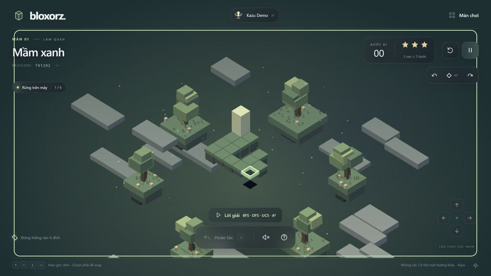
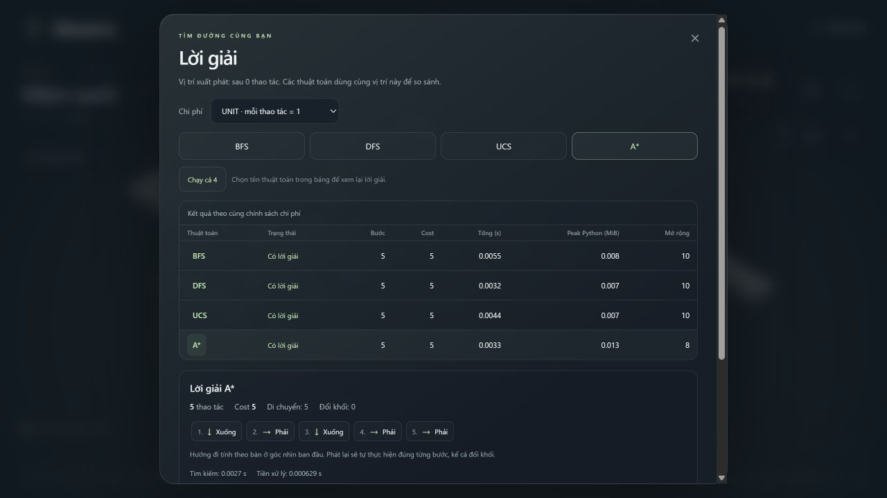
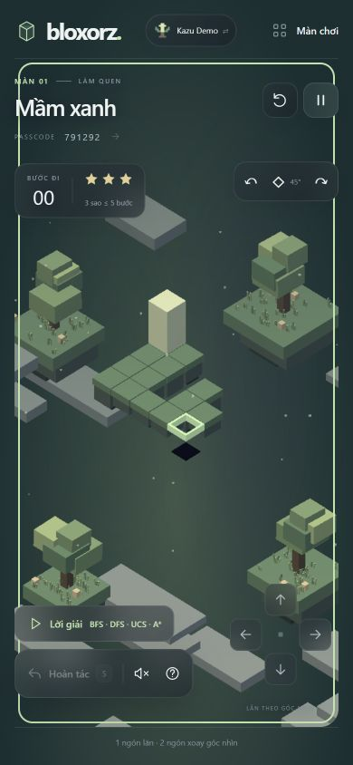
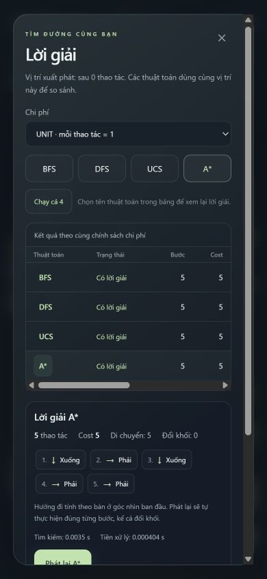

# Kazu + lời giải thuật toán — kiểm tra 31/10/2026

## Nền mã nguồn

- Fetch nhánh `origin/kazu-bloxorz-web`, commit `4d29d28`, rồi khôi phục toàn bộ
  file theo nhánh này trước khi tích hợp tính năng mới.
- Bản làm việc trước đó đã được nén và kiểm tra CRC tại
  `.cache/backups/before-kazu-reset-20261031.zip` (177 mục). File này chỉ ở local,
  được Git bỏ qua. Các file Classic cũ đã được loại khỏi cây mã nguồn đang dùng.
- `board.js`, `biomes.js`, `profiles.js`, `profile-ui.js`, `rolling.js` và
  `impact.js` không thay đổi so với nhánh Kazu.

## Chức năng

- Nút Lời giải mở hộp riêng; chọn BFS/DFS/UCS/A* hoặc chạy lần lượt cả bốn.
- Các thuật toán giải từ cùng snapshot, kết quả lưu riêng theo thuật toán và
  chính sách cost. Có chuỗi thao tác đánh số, gồm SWITCH, và giải thích thuật toán.
- Hiển thị bước, cost, total/search/preprocessing time, expanded nodes và peak
  Python memory. Trạng thái chưa chạy, vô nghiệm, hết thời gian, giới hạn bộ nhớ,
  lỗi và hủy được phân biệt; số liệu không có dùng dấu `—`.
- Replay qua engine từ snapshot đầy đủ; khóa input, có tiến độ và dừng phát lại.
  Ẩn nút đổi cube đang bị khóa trong replay để tránh chồng thanh tiến độ ở mobile.
- Chơi tay/undo/restart/load xóa lời giải cũ. Kết nối lại dừng công việc còn chạy
  trên server để không khóa vĩnh viễn điều khiển.
- Giữ hồ sơ và tiến trình Kazu. Ván đã xem lời giải hoặc replay không ghi kỷ lục;
  restart/load bắt đầu lượt mới. Bản Pages không hiện nút hủy tìm kiếm không được
  hỗ trợ bởi Python đồng bộ trong Web Worker.

## Kiểm tra tự động

- Python: **249 passed**, không skip. Bao gồm engine, solver, worker, controller,
  GUI, campaign, HTTP và solver/replay API mới.
- JavaScript: **84 passed**, gồm 10 test renderer lời giải. Kiểm tra thứ tự bước,
  số liệu thiếu, trạng thái không FOUND, escape dữ liệu và khả năng hủy của runtime.
- `node --check Source/web/app.js` và `git diff --check`: đạt.
- Build Pages thành công với 43 màn tại
  `tmp/pages-kazu-solutions-ready-20261031`.
- Smoke WebAssembly kiểm tra 30 campaign thắng tối ưu, các luật nâng cao, bốn
  solver thật, snapshot/results, replay, split, UCS/A* weighted và giới hạn lượt.

Lệnh kiểm tra:

```powershell
.\.venv\Scripts\python.exe -m pytest Source/tests -q --basetemp tmp/pytest-kazu-check
node --test (Get-ChildItem Source/tests/*.test.mjs).FullName
.\.venv\Scripts\python.exe Source/tools/build_pages.py --output tmp/pages-kazu-build
node Source/tools/smoke_pages.mjs tmp/pages-kazu-build
```

Các thư mục output/basetemp trong lệnh phải là đường dẫn mới phù hợp với lượt chạy.

## Kiểm tra trình duyệt

Chạy HTTP local tại `http://127.0.0.1:8002`, dùng hồ sơ thử Kazu Demo.

| Viewport | Kết quả |
|---|---|
| 1280 × 720 | Bàn Kazu, HUD thu gọn; mở lời giải, chạy cả 4, xem các bước và replay A* |
| 390 × 844 | Không tràn ngang trang; bảng 590 px cuộn trong vùng 299 px |
| 360 × 640 | Trang rộng đúng 360 px; nút thuật toán chia hai cột; dialog nằm trong viewport |
| 844 × 390 | Header, HUD, camera và điều khiển dùng được; không chồng nút Lời giải với D-pad |

Ở Mầm xanh, cả bốn thuật toán trả FOUND 5 bước từ vị trí đầu; A* replay tới đích
đúng 5 bước. Tải lại kiểm tra hồ sơ vẫn 0/30 màn, 0 sao sau lượt có hỗ trợ.
Đổi cost bằng phím giữ focus ở dropdown. Console không có error/warn trong lượt kiểm tra.
Đây là kiểm tra viewport trình duyệt, chưa phải thiết bị điện thoại vật lý.






Source và bản build ở máy local. Website công khai cần triển khai lại từ source mới.
