# Xác minh giao diện Bloxorz Web

Kiểm tra ngày 15–16/10/2026, Asia/Saigon.

## GitHub Pages — 16/10/2026

- Đã chuyển website chính sang [huyokazu.github.io/bloxorz-kazu](https://huyokazu.github.io/bloxorz-kazu/).
  Workflow ở repo `huyokazu/bloxorz-kazu` build từ nhánh `kazu-bloxorz-web` của
  repo đồ án, test Python/JS và replay đủ 30 màn bằng WebAssembly, rồi deploy
  thành công. Tài khoản Kazu quản trị repo deploy này.
- Browser trên URL mới tải được engine và toàn bộ scene từ đường dẫn project.
  Đã tạo hồ sơ Kazu, lăn một bước, Undo về 0 bước, restart để khôi phục 5 lượt
  Undo. Console không có warning/error. Tab bàn giao trỏ đến địa chỉ mới.
- Các phần bên dưới lưu kết quả của những bản trước khi chuyển hosting.

## Website công khai Kazu trước khi chuyển hosting — 16/10/2026 (Asia/Saigon)

- Đã xuất bản thành công trên Sites, chế độ public:
  [Bloxorz by Kazu](https://bloxorz-kazu.bloomybud4.chatgpt.site).
  Source nằm ở nhánh `kazu-bloxorz-web`, tác giả commit Kazu / `huyokazu`.
- CI GitHub chạy thành công với **225 test Python + 74 test JavaScript**,
  build static và smoke test dùng WebAssembly thật. Replay cả 30 campaign
  đúng optimum và 3 sao, gồm tách/ghép khối, fragile, switch và cầu; kiểm tra
  thêm phiên riêng, Pause, Undo, restart và request không hợp lệ.
- Browser trên URL production tải được Python engine từ cùng origin, tạo hồ
  sơ Kazu, chơi màn 1 **5/5 bước, 3 sao**, hiện thời gian 0:11 và thông báo
  lưu thành công. Next nạp màn 2. Reload giữ hồ sơ, 3 sao và màn 2 đã mở.
- Viewport 390×844: form tên/6 avatar và modal thắng hoạt động. 320×568:
  game, selector, form avatar không tràn ngang; game không tràn dọc. 1280×720:
  bố cục desktop không tràn trang. Đã reset viewport sau khi kiểm tra.
- Console không có warning/error trong các luồng trên. Các kiểm tra này bổ
  sung cho giới hạn browser của lượt trước; chưa benchmark điện thoại vật lý.

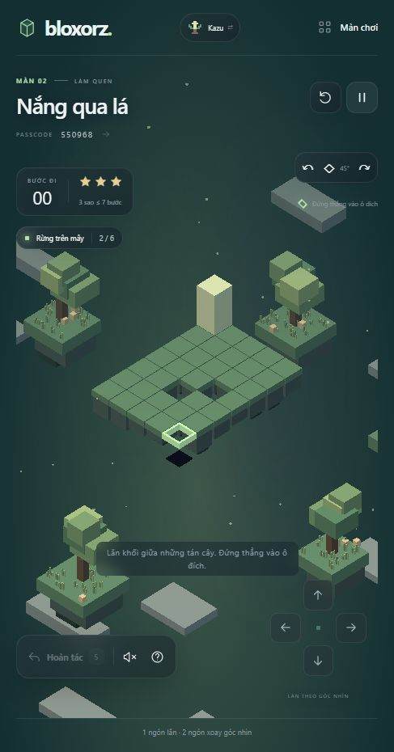

## Hồ sơ nhiều người chơi và game feel — 16/10/2026

- **225 test Python + 69 test JavaScript đạt**. Các ca mới bao phủ tách slot,
  merge độc lập sao/bước/thời gian, reload, migration, Web Locks, lỗi ghi storage,
  khóa màn/passcode và mở rộng catalog vượt 30 màn; đồng hồ loại thời gian pause.
- Kiểm tra trình duyệt: tạo An/avatar fox, thắng màn 1 với **5/5 bước, 3 sao**,
  modal ghi thời gian 0:10 và xác nhận đã lưu. Màn 2 được mở. Passcode màn 2 bị
  từ chối khi An chưa hoàn thành màn 1.
- Tạo Bình/avatar crystal: bắt đầu màn 1, không có sao hay dữ liệu của An,
  màn 2 bị khóa. Chuyển lại An nạp đúng màn 2. Cả header và nút trong Pause
  mở được selector. Sau reload, cả hai hồ sơ giữ đúng tiến trình riêng.
- Kỷ lục cũ tự chuyển vào `Hành trình cũ` một lần, vẫn giữ key nguồn. Thời gian
  không có trong dữ liệu cũ được giữ null. Đã quan sát ba hồ sơ cùng tồn tại.
- Test animation xác nhận lăn 220 ms rồi settle 50 ms, khóa thao tác xuyên cả
  hai giai đoạn; footprint/surface đúng, 8 hạt bụi, nén và lún 0,05 trở về pose
  ban đầu; callback impact không phát khi rơi vào khoảng trống/lỗ đích.
- Shader gió đã biên dịch và hiển thị trong browser, không có warning/error
  ở các luồng trên. Unit test xác nhận gốc neo, ngọn lệch theo thời gian/vị trí,
  và toàn bộ vegetation dùng chung uniform cùng một InstancedMesh.
- Selector desktop 1280×720 đã được quan sát: danh sách dài cuộn từ đầu đến
  cuối, không cắt phần tiêu đề. CSS có breakpoint thu gọn header, thẻ hồ sơ và
  form avatar cho mobile. Lần kiểm tra lại viewport mobile/ảnh preview mới
  chưa thực hiện được vì công cụ browser bị chính sách chặn tab lỗi kết nối;
  các ảnh ở phần dưới thuộc phiên bản trước, không đại diện cho selector mới.
- Chưa benchmark FPS hoặc kiểm tra điện thoại vật lý. Không bật rung tự động;
  ứng dụng có sẵn `onRollStart`, `onImpact(surfaceType, impact)` để gắn haptic.

Chi tiết: [Hồ sơ local và game feel](../Source/web/PROFILES-AND-VFX.md).

## Three.js, orbit và 30 màn — 16/10/2026

- **225 test Python + 54 test JavaScript đạt**. HTTP riêng đạt 54 ca sau lần
  bổ sung asset gestures vào allowlist. Node syntax check app/board đạt.
- Replay cả 30 lời giải qua engine, so sánh optimum bằng BFS trong 2 giây/màn;
  5 biome × 6 màn, 30 layout/start/goal khác nhau. Các màn đại diện không thể
  bỏ qua gạch cam hoặc bỏ nhấn một switch. Loader chấp nhận biomeId hợp lệ và
  giữ mặc định forest cho dữ liệu cũ.
- Camera unit tests: vòng quay không giới hạn, polar luôn 30–71,1°, damping
  độc lập frame rate, reset theo cung ngắn nhất, mapping bốn hướng có tính chu kỳ
  và không trùng tại đường biên; reduced motion vẫn vẽ góc mới.
- Gesture unit tests: chuột phải chỉ orbit; hai ngón dùng delta tâm tiếp điểm,
  nhấc một ngón không phát sinh swipe; cancel/lost capture xóa thao tác chờ.
- Browser: nhìn và tải được cả 5 biome; palette, mây/cây/cột/neon/pha lê/sao
  khác nhau. Xoay bằng nút từ 45° → 135° làm thay đổi cảnh đúng; nút/phím lăn
  sử dụng hướng camera mới. Có kiểm tra lỗi rơi khi hướng mới đi ra ngoài bàn.
- Browser thắng **màn 1: 5/5**, **màn 19: 11/11** (tách, chọn cube, hợp nhất),
  **màn 30: 42/42** (tách, switch, cam, cầu), đều 3 sao. Màn 30 trở về menu.
- Viewport: 1280×720, 390×844, 320×568, 844×390, không tràn trang. Điều chỉnh
  biome tag/goal guide để không chồng score và camera controls trên mobile.
  Chưa kiểm tra trên điện thoại vật lý; hai ngón được kiểm thử ở controller
  thuần JS, chưa thao tác multi-touch bằng trình duyệt tự động.
- Console không có warning/error trong các luồng kiểm tra. Library cục bộ,
  không có request CDN trong game. Backend Python vẫn phục vụ local/LAN.

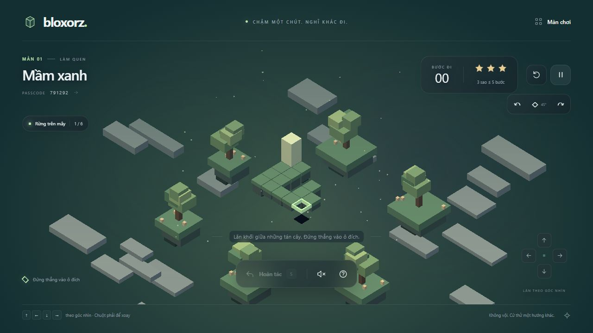

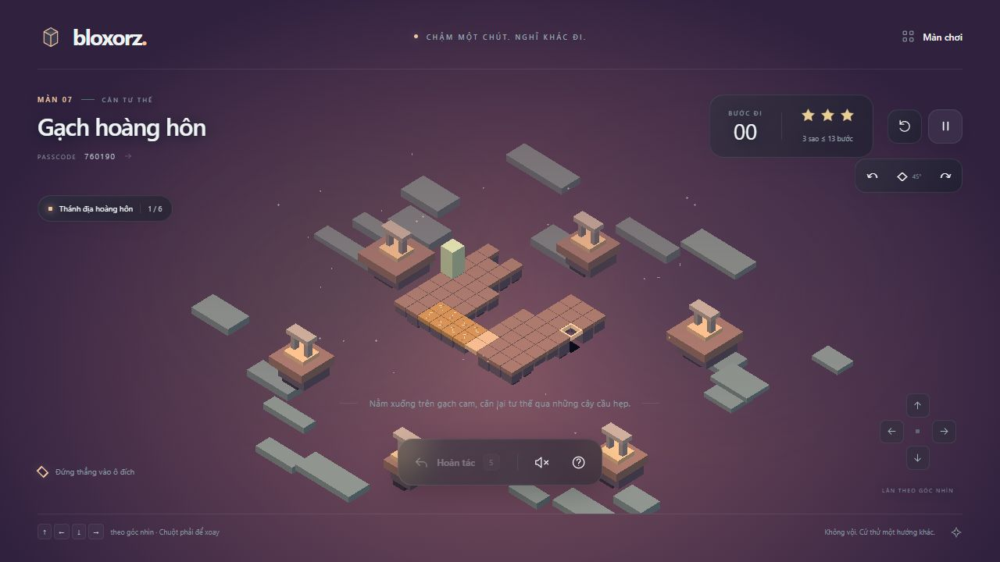

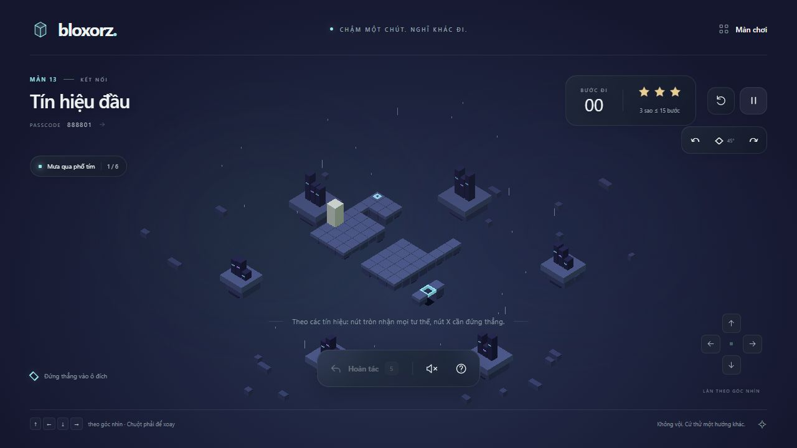

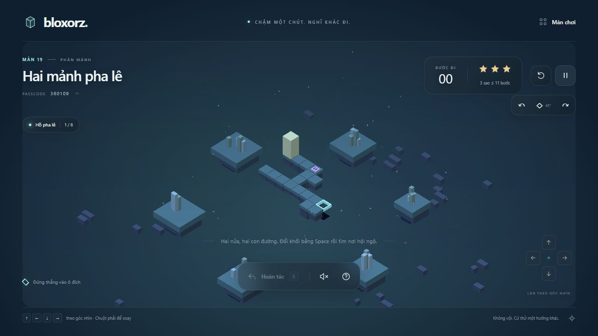

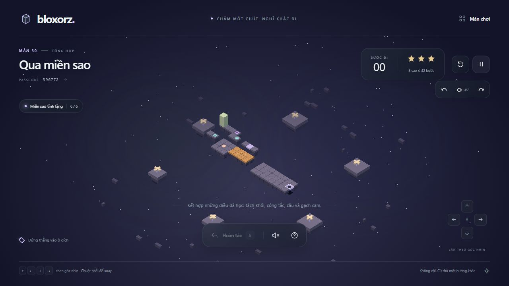

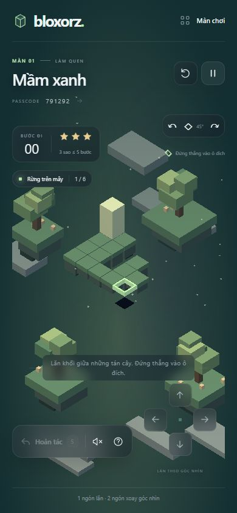

Các mục tiếp theo ghi kết quả của những bản trước.

## Nâng cấp rolling và campaign — 16/10/2026

- Python: **171 passed**, bao gồm 5 màn mới, catalog mặc định và 13 test
  chứng minh tiến trình/cơ chế campaign; toàn bộ kiểm thử cũ vẫn đạt.
- JavaScript: **43 passed** (`rolling.test.mjs` và `board.test.mjs`). Hình học
  đủ 12 chuyển tư thế; cạnh pivot cố định, hình dạng không đổi, không xuyên sàn.
  Renderer giữ state/cầu cũ trong 220 ms lăn, commit sau 90°, rồi mới rơi/tách;
  kiểm tra re-entry, reduced motion và phục hồi khóa nếu tween báo lỗi.
- Đã chơi cả 5 màn qua D-pad trên browser: **6/6, 11/11, 18/18, 24/24,
  37/37 bước**, mỗi màn nhận 3 sao. Màn 5 trả về danh sách, không chuyển
  sang nhóm thử nghiệm. Kỷ lục vẫn còn sau reload.
- Màn 3: `DDDDRR` làm khối đứng trên gạch cam và thua; Undo trở về 5 bước,
  còn 4 lượt Undo. Restart rồi giải lại đủ 18 bước.
- Màn 4/5: nhấn công tắc, qua cầu và quay lại; hoàn thành bằng cùng lời giải
  BFS đã replay trong test engine. Có quan sát các nút di chuyển bị disabled
  trong nước đi trước khi modal thắng xuất hiện.
- Menu mặc định có đúng 5 màn, nhãn độ khó tiếng Việt; nhóm 13 màn cũ được
  thu gọn. Màn cuối hiển thị đầy đủ ở 390 × 844 và 320 × 568, không tràn trang.
- Desktop 1280 × 720: tăng vùng trống dưới bản đồ để chú thích không đè lên
  đảo đích của màn 5. Console không có warning/error trong luồng kiểm tra.
- Responsive được kiểm tra bằng viewport, chưa chạy trên điện thoại vật lý.
  Reduced motion được kiểm thử bằng test renderer, chưa đổi cài đặt hệ điều hành.

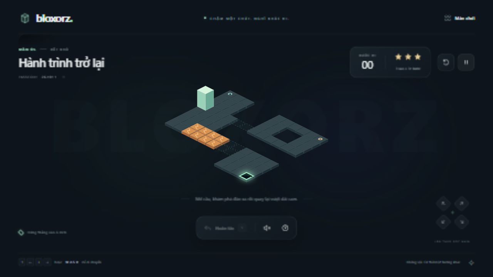

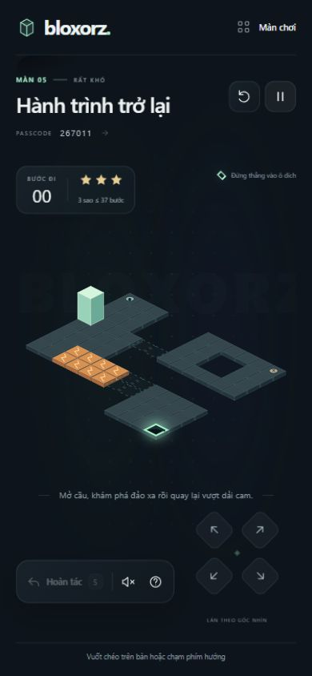

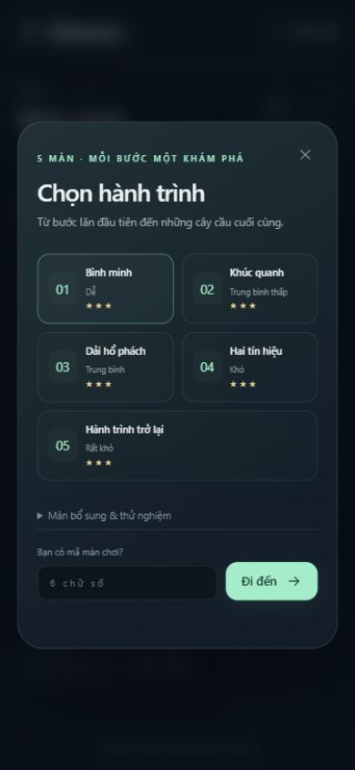

Các mục dưới đây lưu kết quả của bản UI ban đầu, trước khi thêm campaign.

## Môi trường và kiểm thử tự động

- Windows, Python 3.14.8, pytest 9.1.1, môi trường `.venv` của dự án.
- `python -m pytest Source/tests -q`: **151 passed**, không skip.
- Gồm 129 test cũ và 22 ca mới cho web adapter. Bộ cũ vẫn bao phủ GUI Tkinter,
  controller, engine, worker và các solver.
- `node --check` cho `app.js`, `board.js` và Python `compileall`: đạt.

Các ca mới chạy bằng engine thật: pause chặn di chuyển, resume, thắng/thua,
Undo sau khi rơi, khôi phục cầu/cube đang chọn, hết lượt Undo, restart,
đánh giá 1–3 sao, replay lời giải BFS trên cả 13 màn trong catalog web,
phân biệt màn vô nghiệm, mã màn duy nhất, load lỗi không mất phiên.
Kiểm thử HTTP khởi chạy server thật ở cổng tạm để xác nhận các tab độc lập,
token sai, request khác nguồn, JSON sai kiểu và chặn đọc file ngoài allowlist.

## Kiểm tra tương tác trên trình duyệt

Đã kiểm tra qua Codex in-app browser:

| Luồng | Kết quả |
|---|---|
| Mở game và tải bàn | Canvas isometric, HUD, passcode, 0 bước, mục tiêu 7 bước |
| Màn Khoảng lặng | RIGHT, RIGHT, UP, RIGHT, UP, RIGHT, RIGHT → 7/7 bước, 3 sao |
| Victory | Modal có thống kê, sao lần lượt xuất hiện, biểu tượng rơi/dừng nhẹ |
| Next / Replay | Chuyển đúng màn / đặt lại toàn bộ lượt chơi |
| Pause / Resume | Native dialog khóa nền, giữ vị trí và số bước |
| Thua và Undo | Lăn khỏi bàn, hiện modal; Undo phục hồi đúng state, còn 4 lần |
| Bàn phím | ArrowRight di chuyển; Z hoàn tác và cập nhật badge |
| Gesture | Kéo chéo xuống-phải trên canvas tạo một action RIGHT |
| Menu/passcode | Mã sai có thông báo; `346367` mở đúng Khoảng lặng |
| Help / Escape | Mở hướng dẫn, Esc đóng và tiếp tục chơi |
| Âm thanh | Nút loa đổi trạng thái bật/tắt; không có lỗi Web Audio trong console |
| Console | Không có warning/error trong luồng kiểm tra |

Đã quan sát hình ảnh tại các viewport sau:

| Viewport | Kết quả |
|---|---|
| 1280 × 720 | HUD, bàn và thanh nổi nằm đúng vùng, đủ khoảng trống |
| 390 × 844 | Bố cục dọc, D-pad và modal thắng vừa khung |
| 320 × 568 | Bố cục thu gọn, không cuộn ngang/dọc |
| 844 × 390 | Bố cục ngang thấp, điều khiển vẫn nhìn thấy |
| 667 × 375 | Điện thoại nhỏ nằm ngang, toàn bộ giao diện vừa khung |

Kiểm tra responsive bằng viewport trình duyệt, chưa kiểm tra trên thiết bị iOS /
Android vật lý. Reduced motion được triển khai qua media query và renderer;
chưa chạy kiểm tra riêng bằng thay đổi cài đặt hệ điều hành. Giao diện mới cần
Python server đang chạy. Các nút gọi và hiển thị metrics solver vẫn thuộc GUI
Tkinter; giao diện web dùng BFS để tính chuẩn số bước, không có bảng solver riêng.

## Preview

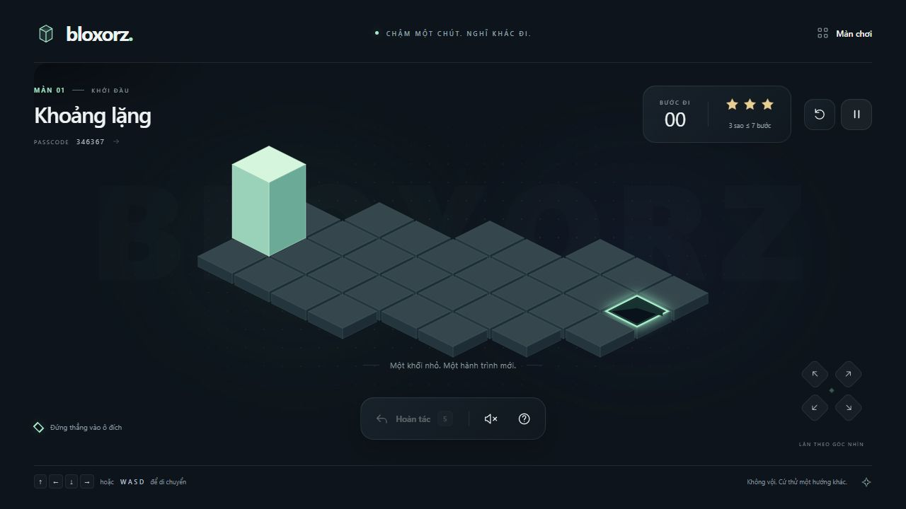

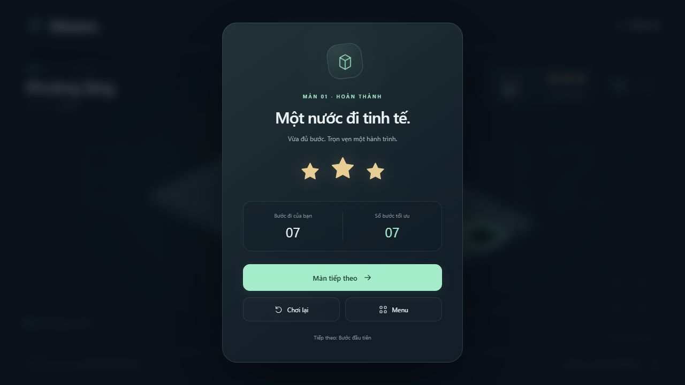

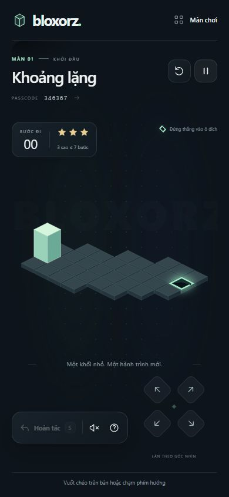

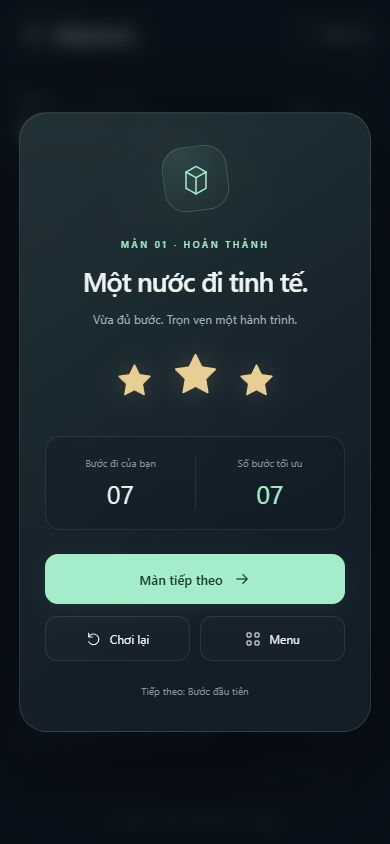
